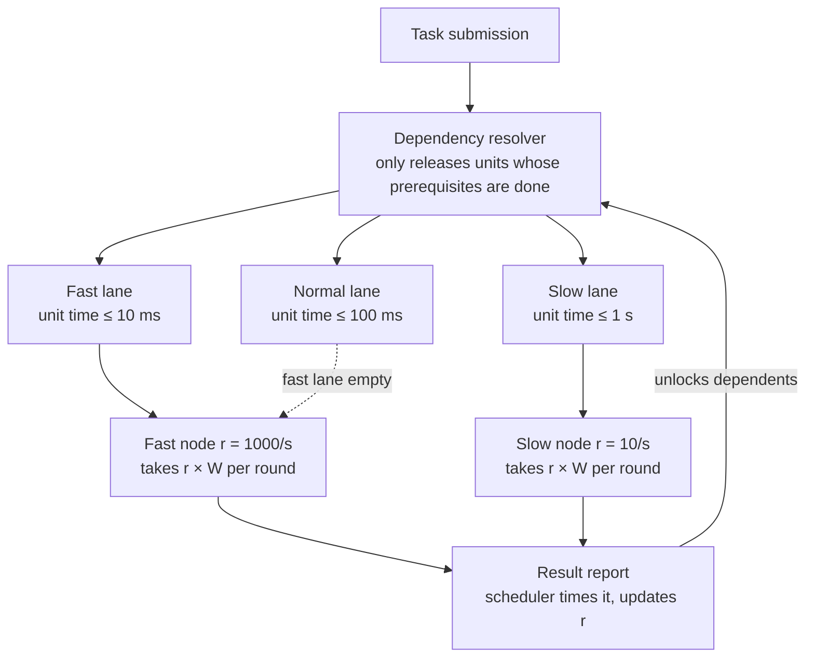

# Asymmetric Distributed Inference

**English** | [中文](README.zh-CN.md)

A scheduling architecture for distributed computation over heterogeneous, idle hardware. Nodes pull work sized to their *measured* capability, so every node returns results inside the same time window and the aggregator never waits for the slowest machine.

## Goals

- Truly decentralized task distribution and result aggregation
- Full use of heterogeneous and idle compute resources
- Computation completed within an agreed time bound, guaranteed by precise capacity measurement
- Less duplicated work, higher overall efficiency
- Fault tolerance and horizontal scalability

## Core idea

Work is expressed as **minimal compute units**: indivisible, idempotent atoms of computation. A node never receives *one* unit; it receives as many as it can finish inside a fixed **time window W**, based on throughput the scheduler has measured from real round trips.

| Node | Throughput | Units taken per round (W = 1 s) | Returns in |
| --- | --- | --- | --- |
| Fast | 1000 units/s | ~1000 | ~1 s |
| Slow | 10 units/s | ~10 | ~1 s |

Both nodes come back at the same time. The aggregator always waits one W, regardless of how uneven the fleet is.

Task pools are split into **lanes** by a per-unit latency ceiling, like fast and slow lanes on a highway. A node qualifies for a lane only if its measured per-unit time (network included) is under that lane's ceiling. Fast nodes may drop down to slower lanes when the fast lane is empty; slow nodes never move up.

## Architecture

Three layers, three responsibilities:

1. **Dependency resolver** — expands each task into a DAG of units and releases a unit into a lane only when all its prerequisites have completed. Nodes never see task logic.
2. **Lane pools** — one ready queue per latency ceiling. Tasks choose a lane by their timeliness requirement; nodes qualify by measured speed.
3. **Node pull with fixed window** — every W, a node takes `throughput × W` units. Throughput is measured by the scheduler from real round trips and smoothed with an EWMA; nodes cannot self-report.

## Documentation

- [Scheduling design](docs/en/scheduling-design.md) — full design: concepts, resolver, lanes, capacity measurement, pull rules, data structures, parameter defaults, open questions
- [调度设计（中文）](docs/zh-CN/scheduling-design.md)

## Status

Design stage. No implementation yet. See the open questions at the end of the design document.

## License

Copyright (c) 2026 BO LI. Released under the [PolyForm Noncommercial License 1.0.0](LICENSE): free for personal, academic and non-profit use; commercial use is not permitted.
