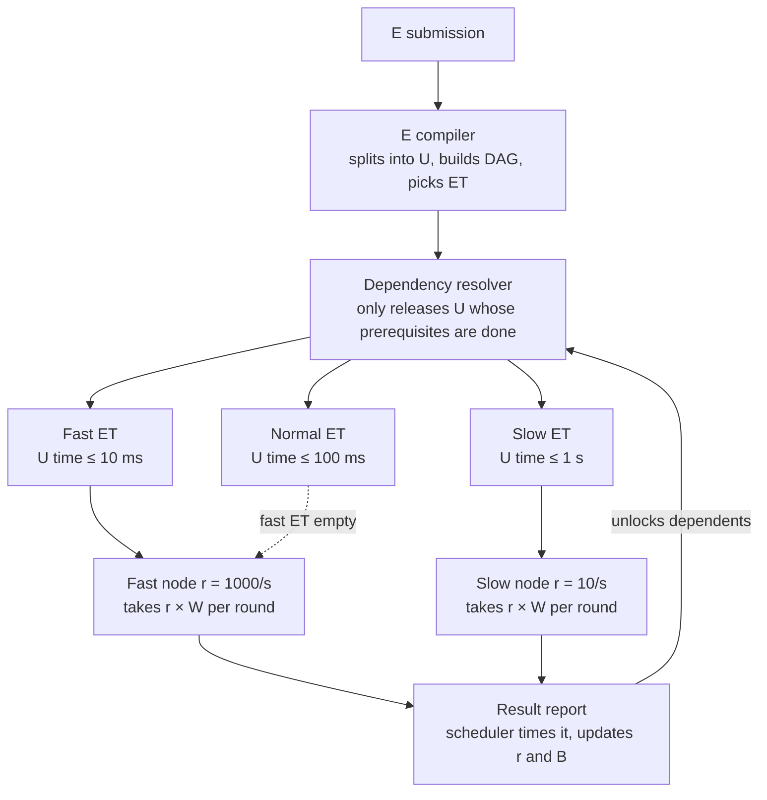

# Asymmetric Distributed Inference

**English** | [中文](README.zh-CN.md)

A scheduling architecture for distributed computation over heterogeneous, idle hardware. Nodes pull work sized to their *measured* capability, so every node returns results inside the same time window and the aggregator never waits for the slowest machine.

## Goals

- Truly decentralized task distribution and result aggregation
- Full use of heterogeneous and idle compute resources
- Computation completed within an agreed time bound, guaranteed by precise capacity measurement
- Less duplicated work, higher overall efficiency
- Fault tolerance and horizontal scalability

## Core idea

Work is expressed as **Unity (U)**: indivisible, idempotent granules of computation, each an operator subgraph plus its input slice, encoded in a hardware-independent IR at the tensor operator graph level. One or more U form an **Event (E)**, the minimal task event; E wait in **Event Trenches (ET)**, buffer pools partitioned by hardware tier and per-U time ceiling. A node never receives *one* U; it receives as many as it can finish inside a fixed **time window W**, based on throughput the scheduler has measured from real round trips.

| Node | Throughput | U taken per round (W = 1 s) | Returns in |
| --- | --- | --- | --- |
| Fast | 1000 U/s | ~1000 | ~1 s |
| Slow | 10 U/s | ~10 | ~1 s |

Both nodes come back at the same time. The aggregator always waits one W, regardless of how uneven the fleet is.

ETs work like fast and slow lanes on a highway. A node qualifies for an ET only if its hardware matches the tier and its measured per-U time (network included) is under that ET's ceiling. Fast nodes may drop down to slower ETs when the fast one is empty; slow nodes never move up.

## Architecture

Three layers, three responsibilities:

1. **E compiler and dependency resolver** — the compiler splits each E into U, builds the DAG and picks an ET; the resolver releases a U only when all its prerequisites have completed. Nodes never see task logic.
2. **Event Trenches** — one ready queue per (hardware tier, time ceiling). E choose an ET by their hardware needs and timeliness; nodes qualify by measured speed.
3. **Node pull with fixed window** — every W, a node takes `throughput × W` U. Throughput and bandwidth are measured by the scheduler from real round trips and smoothed with an EWMA; nodes cannot self-report.

## Documentation

- [Scheduling design](docs/en/scheduling-design.md) — full design: U / E / ET, IR, state machine, capacity measurement, pull rules, data scheduling, extension to AI workloads, data structures, parameter defaults, open questions
- [IR operator set v0](docs/en/ir-ops-v0.md) — the 30 tensor operators, determinism profiles, hardware-tier mapping (draft for review)
- [Scheduling simulator design](docs/en/simulator-design.md) — discrete-event simulator that validates the mechanism before any network code (draft for review)
- [Prototype A design](docs/en/prototype-a-design.md) — scheduler service + node agent on real machines, blocked matmul as the U, comparison against the simulator (draft for review)
- 中文：[调度设计](docs/zh-CN/scheduling-design.md) · [IR 算子集 v0](docs/zh-CN/ir-ops-v0.md) · [调度模拟器设计](docs/zh-CN/simulator-design.md) · [形态 A 原型设计](docs/zh-CN/prototype-a-design.md)

## Status

Design validated by simulation. The scheduling logic is a library crate (`crates/adi-core`) shared by the simulator and the upcoming scheduler service. The scheduling simulator (`sim/`, Rust) completed all five stages; each scenario's `sim/results/<name>/summary.txt` holds the measured V1–V4 verdicts, and the mechanism fixes it forced are recorded inline in the design document. Next: the shape-A prototype.

## License

Copyright (c) 2026 BO LI. Released under the [PolyForm Noncommercial License 1.0.0](LICENSE): free for personal, academic and non-profit use; commercial use is not permitted.
