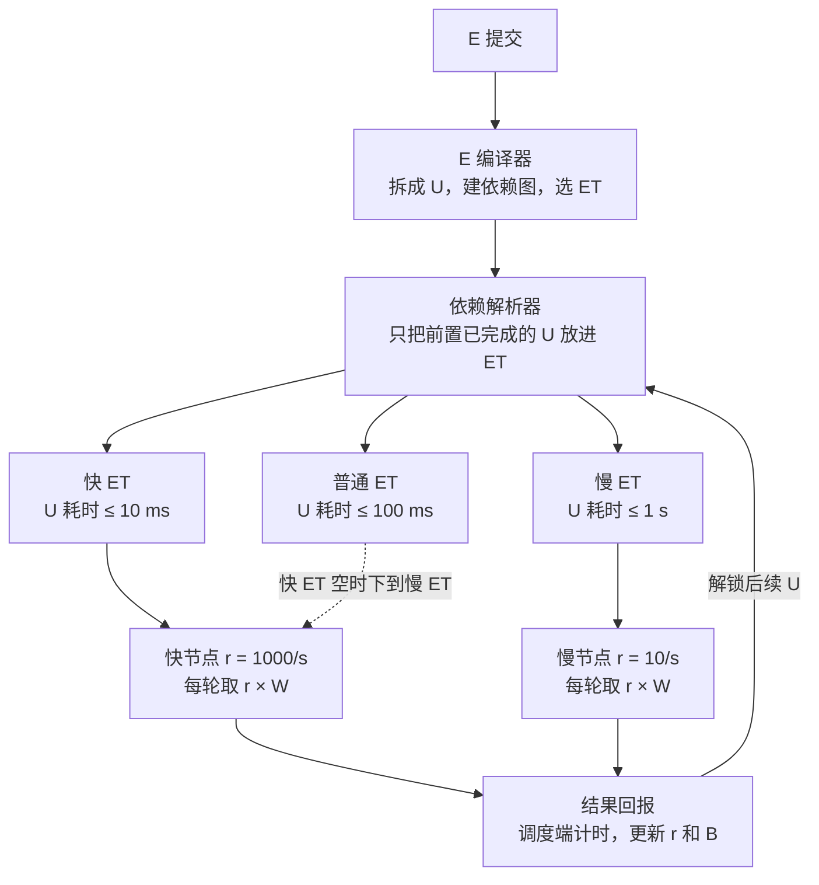

# 非对称分布式 AI 推理架构

[English](README.md) | **中文**

面向异构、闲置硬件的分布式计算调度架构。节点按**实测**能力取量，所有节点在同一时间窗内交回结果，汇总端不再等待最慢的机器。

## 目标

- 实现真正去中心化的任务分发与结果汇总
- 充分利用异构、闲置的计算资源
- 保证在约定时间内完成计算（通过精确的容量度量）
- 减少重复计算，提升整体效率
- 具备良好的容错性与可扩展性

## 核心思路

计算以 **Unity（U）** 表达：不可再分、幂等的最小颗粒，每个 U 是一个算子子图加它的输入切片，用张量算子图层级的硬件无关 IR 编码。一个或多个 U 组成 **Event（E）**，即最小任务事件；E 在 **Event Trench（ET）** 中等待，ET 是按硬件档和单 U 耗时上限划分的缓冲池。节点不是一次拿*一个* U，而是按调度端从真实往返中测出的吞吐，拿它能在固定**时间窗 W** 内跑完的数量。

| 节点 | 吞吐 | 每轮取量（W = 1 s） | 交回用时 |
| --- | --- | --- | --- |
| 快 | 1000 U/s | 约 1000 | 约 1 s |
| 慢 | 10 U/s | 约 10 | 约 1 s |

两个节点同时交回。无论机器快慢多么悬殊，汇总端等的永远是一个 W。

ET 就像公路上的快车道和慢车道。节点硬件匹配该档、且实测单 U 耗时（含网络）低于该 ET 上限，才有资格取它的 U。快 ET 空了，快节点可以下到慢 ET；慢节点永远不能上快 ET。

## 架构

三层各司其职：

1. **E 编译器与依赖解析器** — 编译器把 E 拆成 U、建依赖图、选 ET；解析器只在前置全部完成时才放出 U。节点不感知任务逻辑。
2. **Event Trench** — 每个 (硬件档, 耗时上限) 一条就绪队列。E 按硬件需求和时效选 ET，节点按实测速度取得资格。
3. **节点定窗取量** — 每隔 W，节点取 `吞吐 × W` 个 U。吞吐和带宽由调度端从真实往返中测出并用 EWMA 平滑，节点不能自报。

## 文档

- [调度设计](docs/zh-CN/scheduling-design.md) — 完整设计：U / E / ET、IR、状态机、能力评估、取量规则、数据调度、AI 计算延伸、数据结构、参数建议、待定项
- [IR 算子集 v0](docs/zh-CN/ir-ops-v0.md) — 30 个张量算子、确定性档、硬件档映射（草案待审）
- [调度模拟器设计](docs/zh-CN/simulator-design.md) — 在写网络代码前用离散事件模拟验证机制（草案待审）
- [形态 A 原型设计](docs/zh-CN/prototype-a-design.md) — 真实机器上的调度端服务 + 节点代理，U 为分块矩阵乘，与模拟器对照
- [形态 A 运行手册](docs/zh-CN/prototype-a-runbook.md) — 在你的机器上运行调度端、节点和提交方
- English: [Scheduling design](docs/en/scheduling-design.md) · [IR operator set v0](docs/en/ir-ops-v0.md) · [Simulator design](docs/en/simulator-design.md) · [Prototype A design](docs/en/prototype-a-design.md) · [Runbook](docs/en/prototype-a-runbook.md)

## 状态

设计已通过模拟验证。调度逻辑是独立的库（`crates/adi-core`），模拟器和即将到来的调度端服务共用。调度模拟器（`sim/`，Rust）五个阶段全部完成，各场景的 `sim/results/<名称>/summary.txt` 记录 V1–V4 实测判定，模拟器逼出的机制修正已内联写进设计文档。形态 A 原型（`crates/adi-scheduler`、`adi-node`、`adi-submit`）已端到端跑通，结果与 strict 参考逐位一致。下一步：在真实异构机器上实测（`docs/zh-CN/prototype-a-runbook.md`）。

## 许可证

Copyright (c) 2026 BO LI。以 [PolyForm Noncommercial License 1.0.0](LICENSE) 发布：个人、学术和非营利用途免费，禁止商业用途。
