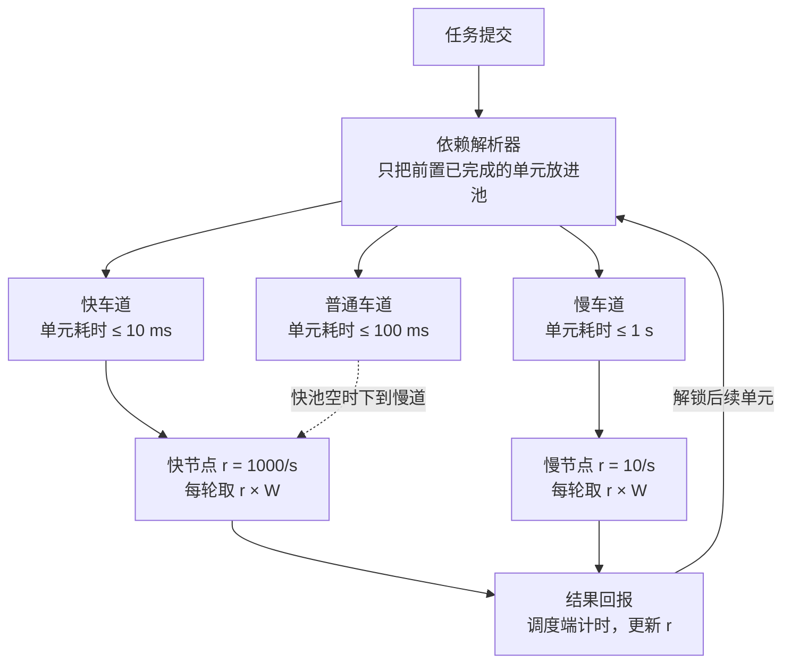

# 非对称分布式 AI 推理架构

[English](README.md) | **中文**

面向异构、闲置硬件的分布式计算调度架构。节点按**实测**能力取量，所有节点在同一时间窗内交回结果，汇总端不再等待最慢的机器。

## 目标

- 实现真正去中心化的任务分发与结果汇总
- 充分利用异构、闲置的计算资源
- 保证在约定时间内完成计算（通过精确的容量度量）
- 减少重复计算，提升整体效率
- 具备良好的容错性与可扩展性

## 核心思路

工作以**最小计算单元**表达：不可再分、幂等的原子计算。节点不是一次拿*一个*单元，而是按调度端从真实往返中测出的吞吐，拿它能在固定**时间窗 W** 内跑完的数量。

| 节点 | 吞吐 | 每轮取量（W = 1 s） | 交回用时 |
| --- | --- | --- | --- |
| 快 | 1000 单元/s | 约 1000 | 约 1 s |
| 慢 | 10 单元/s | 约 10 | 约 1 s |

两个节点同时交回。无论机器快慢多么悬殊，汇总端等的永远是一个 W。

任务池按单元耗时上限分成多条**车道**，就像公路上的快车道和慢车道。节点的实测单元耗时（含网络）低于某车道上限才有资格取该车道的单元。快车道空了，快节点可以下到慢道；慢节点永远不能上快道。

## 架构

三层各司其职：

1. **依赖解析器** — 把任务展开成单元的有向无环图，只在前置全部完成时才把单元放进车道。节点不感知任务逻辑。
2. **车道任务池** — 每个耗时上限一条就绪队列。任务按时效要求选车道，节点按实测速度取得资格。
3. **节点定窗取量** — 每隔 W，节点取 `吞吐 × W` 个单元。吞吐由调度端从真实往返中测出并用 EWMA 平滑，节点不能自报。

## 文档

- [调度设计](docs/zh-CN/scheduling-design.md) — 完整设计：概念、解析器、车道、能力评估、取量规则、数据结构、参数建议、待定项
- [Scheduling design (English)](docs/en/scheduling-design.md)

## 状态

设计阶段，尚无实现。待定问题见设计文档末尾。
