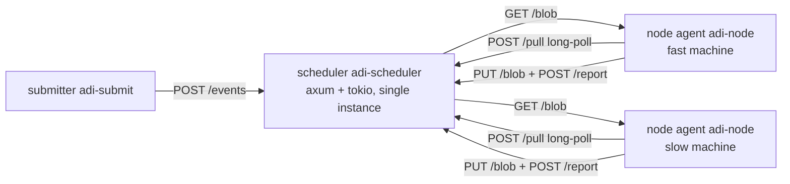

# Prototype A — Design

**English** | [中文](../zh-CN/prototype-a-design.md)

Draft for review · 2026-10-22

## 1. Purpose and scope

Run "scheduler + node agent" on two or three real heterogeneous machines and check the simulator's prediction: once nodes take work sized by measured throughput, does aggregation waiting really shrink to one W, and is efficiency close to the simulated value? The U is fixed as a blocked matrix multiply (general tier, CPU) — shape A from section 11 of the design document, and the cheapest carrier for validating the mechanism.

**In scope:**

- Scheduler service: node registration, pull (long-poll), report, timeout reclaim, ETs, dependency resolution — logic reused directly from the simulator's `scheduler/` module.
- Node agent: register, pull, fetch data by content hash and cache it, compute multithreaded, upload results, report.
- One kind of U: one output block of C = a row block of A × a column block of B (full K accumulation, no reduce stage).
- rounds.csv / batches.csv / summary.txt in the simulator's format, for direct comparison.

**Out of scope (later):**

- IR translator: the U's logic_hash is a placeholder; the node has a built-in matmul kernel.
- Peer-to-peer distribution of content-addressed data: data is fetched from the scheduler and cached locally.
- Result verification, malicious-node eviction, GPU runtime, critical-path priority, straggler duplication.

## 2. Process structure



Three Rust binaries and one shared library:

| Crate | Content |
| --- | --- |
| `crates/adi-core` | Scheduling logic extracted from `sim/src/scheduler/` (node table, ETs, quotas, hysteresis, timeouts, resolver) plus `metrics`; shared by the simulator and the scheduler |
| `crates/adi-scheduler` | HTTP service holding one `adi-core::Scheduler` (single instance, behind a `Mutex`), a timer running the timeout check every W/4, a content store (memory + disk) |
| `crates/adi-node` | Node agent |
| `crates/adi-submit` | CLI: generate A and B, upload, submit E, wait, verify C |

`sim/` becomes a dependency of `adi-core`; `engine.rs` is unchanged. There is one copy of the scheduling logic: what the simulator validated is what runs.

## 3. Protocol

Control plane: JSON over HTTP/1.1 (axum). Data plane: binary blobs. One round trip per round means small message volume, so JSON is enough; data never goes through JSON.

| Method | Path | Request | Response |
| --- | --- | --- | --- |
| POST | /nodes/register | `{node_id, tier, c, hardware: {cores, mem_bytes}}` | `{token, w, retry_ms}` |
| POST | /pull | `{node_id, wait_ms}` | 200 `{round_id, et, issued_at, units: [{u_id, e_id, logic_hash, input: {a, b, bi, bj, block}}]}`, or 204 after wait_ms with no work |
| POST | /report | `{node_id, round_id, started_at, finished_at, bytes_in, results: [{u_id, hash}]}` | 200 `{accepted: [u_id]}` |
| PUT | /blob/{hash} | raw bytes | 201 |
| GET | /blob/{hash} | — | raw bytes |
| POST | /events | `{a_hash, b_hash, block, et}` | `{e_id, units}` |
| GET | /events/{e_id} | — | `{status, done, total, c_hash?}` |
| GET | /metrics | — | current rounds.csv / batches.csv / summary.txt |

Conventions:

- The scheduler records issued_at itself (when /pull returns) and returned_at (when /report arrives); these define t. The node's started_at / finished_at only separate transfer from compute, to estimate B.
- /pull is a long-poll: with no work the server holds the request up to wait_ms (= W/4); when a U becomes ready it wakes one parked request, the fastest eligible node.
- /report carries round_id; a late report (round already reclaimed) is accepted as usual, results are first-come per u_id.
- Idempotent: a repeated report for the same u_id returns `accepted: []`.
- Timestamps come from the server's monotonic clock (seconds, f64); node clocks play no part in timing.

## 4. Unity: blocked matrix multiply

E = compute C = A × B, A is M×K, B is K×N, f32. Block size b (default 64). U(i, j) computes block (i, j) of C:

```
C[i·b .. (i+1)·b, j·b .. (j+1)·b] = Σ_k A[row block i, k] · B[k, column block j]
```

Number of U = ⌈M/b⌉ × ⌈N/b⌉; each U costs b × b × K multiply-adds, uniform. Strict profile: per output element, accumulate along K in ascending order in f32, so every node's result is bit-identical and the submitter can compare directly.

Data by reference: a U carries only a_hash, b_hash, bi, bj. On first sight of a hash the node GETs the whole matrix and caches it (once each for A and B); later U transfer nothing. This is the minimal form of the design's "data by reference, node cache"; for the prototype it also means B has signal only in the first round, bytes_in = 0 afterwards.

Results: each U's C block (b × b × 4 bytes, 64 KB at b = 128) is PUT to /blob; the report carries only the hash. The submitter assembles C by u_id at the end. Upload completes before the report, so upload time is naturally part of t; a WAN node's upload bandwidth shows up directly as a longer t and a lower r, which is exactly what "t includes network transfer" means in the design.

Granularity: fixed per-U overhead is about 1 ms (JSON, hashing, HTTP), so by the "≥ 100×" rule a U should compute for ≥ 100 ms on the slowest machine. With b = 64 and K = 4096 a U is 16.8 M multiply-adds, roughly 10–30 ms on one core — too small. Start with b = 128 (67 M multiply-adds, 50–150 ms per core) and adjust after measurement.

## 4a. Deployment: LAN and WAN

Machines are unrestricted and the network includes the public internet, so the prototype is designed under the constraints below; a LAN is just the easy case:

| Constraint | Approach |
| --- | --- |
| Nodes may sit behind NAT with no public address | Every connection is initiated by the node (register, pull, fetch, upload, report); the scheduler never dials a node. The pull model satisfies this by construction. The scheduler needs one reachable address: listen directly on a LAN, behind a reverse proxy (TLS) on the internet |
| WAN round trip 50–200 ms, far above a LAN's 1 ms | W belongs to the ET, not a global constant: LAN ET W = 1 s, WAN ET W = 3–5 s (≥ 20× round trip). The prototype starts with one ET at W = 3 s, nodes from both networks mixed, and checks whether V1/V2 still hold |
| Narrow WAN upload (5–20 Mbps is common); 64 KB per U at b = 128 | WAN nodes are throttled by result upload. That is a real constraint and not worked around: t includes upload, r shrinks, the node takes less. The measurement gives "how much lower a WAN node's effective r is than its compute" — the first real data for the data-cost model of design section 10 |
| First fetch of A and B is 64 MB each (4096² × f32), tens of seconds over WAN | Happens once, in the first round, and is captured by the first-round B measurement; zero transfer afterwards. Slow start takes c U in the first round, so a long first round does not inflate later quotas |
| A public endpoint gets scanned | The token returned by registration goes in a Bearer header on every later request; that is the only layer in the prototype, TLS is left to the reverse proxy |
| Any OS (Windows / Linux / macOS) | Pure Rust, no system dependencies, `cargo build` is enough; cache directory and core detection through cross-platform crates (`num_cpus`, `dirs`) |

WAN nodes land in a slower ET naturally because their t is larger — the lane mechanism working as designed; acceptance check 6 looks at exactly this.

## 5. Node agent

```
register → loop {
  pull(wait = W/4)
  on 204: continue
  for every uncached a_hash / b_hash in units: GET /blob, store locally
  started_at = now
  compute units in parallel with rayon (parallelism = c = physical cores)
  finished_at = now
  PUT /blob/{hash} for each result (concurrently)
  report
}
```

- c is reported as the physical core count; the scheduler uses c only for the slow-start first round and the t = c ÷ r conversion.
- The node takes w and retry_ms from the scheduler; it carries no parameters of its own.
- Killing the process is "going offline": no graceful shutdown, so timeout reclaim and reconnect reclaim get exercised (after restart it re-registers and the scheduler reclaims its stale round at once).
- Cache directory configurable, cleared at start.

## 6. Inside the scheduler

- `adi-core::Scheduler` as is: `pull(node, now)`, `round_done(obs, units)`, `check_timeouts(now)`, `node_reconnected(node)`, `submit(et, u, cost, bytes, deps)`.
- One `tokio::sync::Mutex<Scheduler>`; each handler takes the lock, makes one call, releases it. Decisions are microseconds; the lock is not the bottleneck.
- Long-poll: one `tokio::sync::Notify` per node; an empty pull waits on it; `submit` / `round_done` / reclaim call the server version of `wake_parked()`, which notifies one node by "eligible and fastest".
- A timer task calls `check_timeouts(now)` every W/4.
- Content store: `HashMap<hash, Bytes>` plus a disk directory; BLAKE3 hashes.
- Metrics: `adi-core::metrics` reused; /metrics readable at any time; written to disk on exit.

## 7. Acceptance and comparison method

1. **Single-machine sanity**: 1 node, M = N = K = 4096, b = 128 → 1024 U. C matches a single-threaded reference bit for bit (strict).
2. **Two heterogeneous machines**: 1 fast, 1 slow (throughput ratio ideally ≥ 5), 10 E submitted sequentially. Check V1 (max − min ≤ 0.2 W) and V2 (≤ W) in summary.txt.
3. **Simulator comparison**: generate a scenario.toml from the measured per-node r, B and latency, run the simulator, compare total time over the 10 E. **Pass line: measured ÷ simulated ≤ 1.15.** Beyond that, the real system has an overhead the simulator does not model, and it has to be found.
4. **Churn**: kill the slow node's agent mid-E, restart it 10 s later. Check V4 and reconnect reclaim (reissued > 0, late_results = 0 or present and deduplicated).
5. **Three machines** (if a third exists): add a medium one, check V1/V2 still hold across three throughput levels.
6. **LAN + WAN mixed**: at least one WAN node runs in the same ET (W = 3 s) as the LAN nodes. Check the gap between the WAN node's measured r and its compute capacity (the cost of upload throttling) and whether V1/V2 hold; then open two ETs (LAN W = 1 s, WAN W = 3 s) and check that the WAN node lands in the slow ET on its own.

## 8. Effort estimate

| Stage | Content | Estimate |
| --- | --- | --- |
| P1 | Extract `adi-core`, repoint the simulator, every scenario result unchanged | 0.5 day |
| P2 | `adi-scheduler`: register, long-poll pull, report, blob, timeout timer, /metrics | 1 day |
| P3 | `adi-node` + `adi-submit`: matrix generation, upload, pull, rayon matmul (strict), upload, report, assembly and check | 1 day |
| P4 | Run checks 1–3 on your two machines, write the comparison report | 0.5 day |
| P5 | Churn test, third machine, two ETs (fast / slow) | 0.5 day |

Each stage is committed separately. P1 proceeds to P2 only after the simulator results are verified byte-identical on your machine; P4's measured data goes into the repository under `results/real/`.

## For your confirmation

- [x] Machines: CPU, cores, memory and OS unrestricted; network includes LAN and WAN (confirmed, see 4a).
- [ ] Control plane as JSON over HTTP (simple, curl-debuggable) or a binary protocol from the start? Suggest JSON first; switch when a bottleneck shows.
- [ ] Is b = 128, K = 4096 an acceptable starting point?
- [ ] Node agent with rayon only, or reserve a backend abstraction for the later GPU runtime? Suggest a `trait Kernel { fn run(&self, u: &Unit) -> Block }` with one CPU implementation now, nothing more.

The last three proceed as suggested unless you object.
