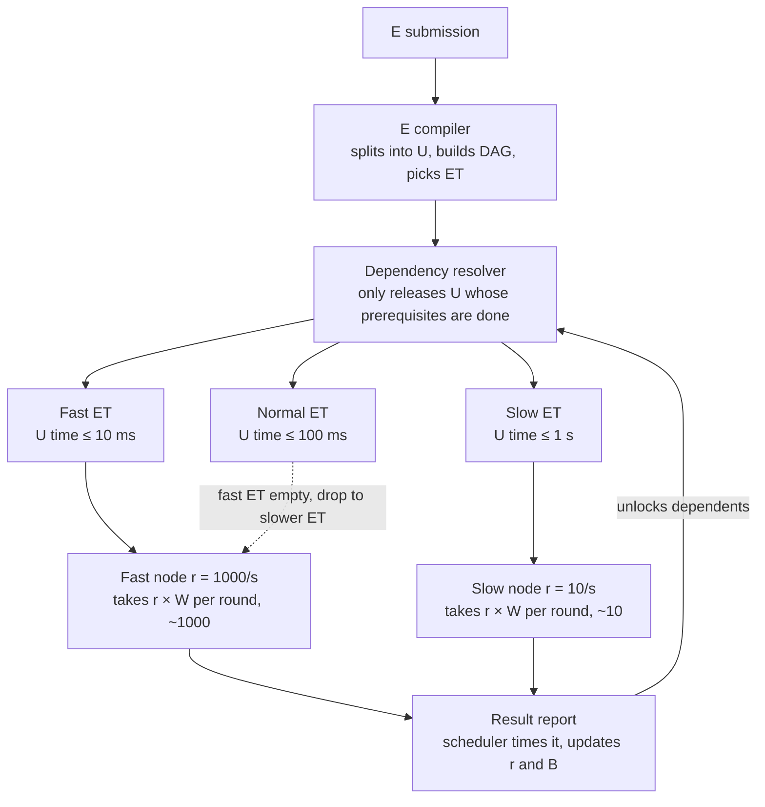

# Distributed Compute Scheduling — Design (U / E / ET)

**English** | [中文](../zh-CN/scheduling-design.md)

Draft v2 · 2026-10-22

## 1. Overview and goals

The goal is to have every node return its results inside the same time window, so that the aggregator's waiting time is independent of how fast or slow individual nodes are. Computation is split into indivisible minimal granules called Unity (U); each node decides how many to take per round from its *measured* throughput. Fast nodes take more, slow nodes take less, and all of them return within the same window W.

**Problem being solved.** Heterogeneous nodes differ enormously in capability (in the running example, a fast node completes 1000 U per second while a slow node completes 10). Distributing equal counts makes fast nodes idle while they wait for slow ones, and each batch boundary is held back by the slowest participant.

**Design principles.**

- Nodes are unaware of task logic. They only pull U, compute, and return results.
- Capability is measured by the scheduler, never self-reported by nodes.
- Estimates will always carry error; the distribution mechanism itself must absorb it (end-of-batch tapering, timeout reclaim).
- U must be idempotent so they can be re-issued or duplicated.
- The scheduler performs no computation of its own; even result aggregation runs on nodes. That is what makes the system truly decentralized.

## 2. Terminology

| Term | Abbr. | Meaning |
| --- | --- | --- |
| Unity | U | The indivisible minimal compute granule: one operator subgraph plus its input slice, self-contained and idempotent. The basic unit of distribution and metering; a node may take many per round |
| Event | E | The minimal task event, made of one or more U; the relationships between them (serial / partially dependent / parallel) are fixed when E is compiled |
| Event Trench | ET | A buffer pool holding many E, partitioned along two axes: hardware tier and U-time ceiling (previously called "lane") |
| Intermediate representation | IR | The hardware-independent encoding of a U's compute logic, defined at the **tensor operator graph** level; node-side runtimes translate it to native code |
| Unit time | t | Time from a node taking a U to the scheduler receiving its result, network included. Measured by the scheduler |
| Concurrency | c | Number of U a node can execute at once (cores, VRAM, etc.) |
| Throughput | r | U a node completes per second, r = c ÷ t, with t measured under concurrency |
| Bandwidth | B | A node's measured data-fetch rate, tracked separately from r |
| Time window | W | Target duration of one pull round. A node takes r × W U and is expected to return them within W |
| Threshold | — | An ET's U-time ceiling. A node whose t exceeds it is ineligible for that ET |
| EWMA | — | Exponentially weighted moving average, used to smooth t, r and B |

"Unity" shares its name with the Unity game engine; public documents note the project's meaning on first use.

## 3. Architecture

Three layers, each with one responsibility: the dependency resolver releases only ready U into the ETs; ETs are partitioned by hardware tier and time ceiling; nodes pull every W, taking `throughput × W` U. Results return to the scheduler, which updates the node's throughput and notifies the resolver to unlock dependents.



Thresholds and counts are illustrative, W = 1 s. The diagram shows only the time axis; the hardware-tier axis is in section 6.

A submitted E is first compiled into U and assigned an ET, then released by the resolver according to dependencies. Fast nodes pull from the fastest ET they qualify for and drop to slower ones when it is empty; slow nodes can only pull from ETs they qualify for. Result reports go through the scheduler, which both times them and triggers unlocking.

## 4. Unity

### 4.1 Packet structure

A U is a self-contained minimal granule. It borrows the cross-hardware **principle** of Wasm — one hardware-independent IR, translated by a per-platform runtime — without using Wasm itself. A U packet contains:

| Field | Description |
| --- | --- |
| u_id | Globally unique identifier, a content hash |
| e_id | Owning E |
| logic_hash | Content hash of the compute logic (an IR subgraph); logic is referenced, never embedded |
| input | The input slice: inlined when under the inline threshold, otherwise a content-addressed reference |
| output_schema | Output shape and type, plus the verification mode (exact match / tolerance ε) |
| hardware_req | The minimum hardware tier the IR subgraph needs (derived from its operator set) |
| created_at | Creation timestamp, used for E-level timeout and ordering within an ET |
| nonce | Prevents id collisions between U with identical content |

Logic and large inputs are both referenced: when an E spawns a million U, the IR travels once; a node fetches, translates and caches it on first sight.

### 4.2 IR: tensor operator graph

The IR is defined at the tensor operator graph level (comparable to ONNX or StableHLO), not as general-purpose bytecode. Reasons:

- A small operator set (initially ≤ 30: matrix multiply, elementwise ops, reductions, shape ops, a few activations) lowers directly to GPU / NPU / LPU.
- U with the same logic_hash are naturally batchable (see 4.4).
- A dataflow graph has no arbitrary branching, so determinism is easy to guarantee.

Control flow (loops, conditionals) is not placed inside U; it is expressed at the E level: an E may spawn further E, and loops and branches appear in the dependency graph (see 5.3).

Node-side runtime: one runtime per hardware class translates the IR to native code and caches it. The IR can access only the U's own input and its declared output — no files, no network, no system calls. This sandbox is the precondition for admitting untrusted nodes.

### 4.3 Granularity rule

"Indivisible" is a logical property; the size still needs a quantitative rule:

> A U's compute time on the slowest eligible hardware ≥ 100 × the fixed per-U overhead (packet, scheduling, translation).

For example, with 1 ms of fixed overhead a U must give the slowest node at least 100 ms of work. The ratio is a parameter of E compilation. Too small and overhead dominates; too large and the tail grows.

### 4.4 Batching

U stay small; GPU efficiency is recovered by node-side merging. U sharing a logic_hash can be merged into one batch; a GPU node takes thousands of same-logic U per round and issues a single large kernel. This matches the "a node may take many U at once" rule and avoids per-hardware compilation.

### 4.5 Determinism

On CPUs, integer and floating-point results can be compared exactly once the IR fixes reduction order. GPU floating-point reduction order is not fixed, so cross-node verification uses a tolerance. The verification mode is declared in output_schema.

## 5. Event

### 5.1 Compilation and simplification

On submission the compiler splits an E into U and builds the dependency graph. Complex computation is first simplified into more widely supported basic operators (a high-dimensional matrix product is blocked into small block multiply-adds); the resulting two-level "multiply → add" dependency is handled by the resolver.

Logic that cannot be simplified (specific-precision tensor cores, special operators) gets its hardware_req derived from the operator set at compile time and is placed in the ET of the matching hardware tier, where it waits for an eligible node.

### 5.2 Aggregation as a U

An E's aggregation logic (aggregate_spec) is compiled into a "reduce U" that depends on all other U and runs on a node; the scheduler takes no part in computation. Large E may aggregate through a multi-level reduction tree.

### 5.3 E spawning E

Iterative algorithms (another round after a convergence check) generate new E dynamically once results are in and attach them to the dependency graph. The graph may grow at runtime; it need not be fixed at submission.

### 5.4 State machine

**U states:** `ready → issued → done`, with side paths `reissued` (reissued after timeout reclaim, counter +1) and `verified` (passed sampled recomputation). Exceeding the retry limit marks the U `failed` and propagates to the E.

**E states:**

| State | Entry condition |
| --- | --- |
| created | Submitted, not yet compiled |
| compiled | Split into U, dependency graph built |
| queued | At least one U has entered an ET; none taken yet |
| computing | At least one U has been taken |
| dispatched | All U have been taken (sub-state of computing, issued_count = total) |
| aggregating | All U returned; the reduce U is executing |
| completed | Reduction finished |
| failed | Some U exceeded its retry limit, or the E-level timeout fired |
| cancelled | Withdrawn by the submitter; results of in-flight U are discarded on arrival |

State is not stored separately; it is derived from four counters, `total / issued_count / done_count / failed_count`, so state and counts cannot disagree.

### 5.5 Additional rules

- Order of U within an E follows the dependency graph; order of E within an ET defaults to FIFO and may be prioritized by deadline or critical-path length.
- E-level timeout is independent of U-level timeout: a U timeout triggers reissue, an E timeout triggers failure.
- Timestamps: created_at serves E-level timeout and ordering within an ET; issued_at is recorded by the scheduler for U-level timeout; nodes report started_at / finished_at so the scheduler can separate compute time from transfer time.

## 6. Event Trench

### 6.1 Two axes

An ET's key = (hardware tier, U-time ceiling).

The hardware tier descriptor is `{backend, min_mem, features}`. To avoid fragmentation, start with three tiers:

| Tier | Covers |
| --- | --- |
| General | Any CPU that can run the base operator set |
| General GPU | Devices supported by the general GPU runtime |
| Specialized | Specific GPU architectures, NPUs, LPUs; requires special operators |

Example time ceilings:

| ET | U-time ceiling | Suited E |
| --- | --- | --- |
| Fast | 10 ms | Latency-sensitive, long serial chains |
| Normal | 100 ms | General |
| Slow | 1 s | Relaxed deadlines, tolerant of slow nodes |

Node eligibility = hardware match (hard condition) and measured t under the ceiling (soft condition). Because t includes network transfer, a node with fast compute but poor connectivity naturally lands in a slower ET.

### 6.2 Rules between ETs

- Fast traffic may drop down; slow traffic may never move up. On each pull a node first checks the fastest ET it qualifies for and moves to slower ones only when that is empty. Among ETs with the same ceiling, its **own tier** comes first: a GPU node serves the work only it can do before dropping into the general ET. (Simulator stage 5: without this order GPU nodes went to the general ET first and GPU work sat idle.)
- Nodes pull every W, so when new U land in a fast ET, a fast node returns to it within at most W.
- A node that qualifies for no ET receives no U; it stays in the node table and is re-enabled when its t recovers.
- Backpressure: when an ET's ready U exceed its capacity, compilation of new E into it pauses instead of piling up without bound.

## 7. Dependency resolver

The resolver does one thing: it places U whose prerequisites have all completed into the matching ET. Nodes only ever see U that can execute immediately.

1. After compilation, each U records the set of U it depends on.
2. U with no prerequisites enter an ET immediately; all others are *waiting* and sit in no ET.
3. When a U's result reaches the scheduler, the resolver finds every U that lists it as a prerequisite, checks whether all of that U's prerequisites are done, and if so marks it ready and enqueues it.
4. A serial E has exactly one ready U at a time; a parallel E has all U ready at once; partial dependency lies between. The node side is identical in all cases.

## 8. Node capacity measurement

Node capacity is derived by the scheduler from the round-trip time of real U. There is no separate benchmark phase and no self-reporting.

**Two numbers, not one.** The scheduler measures compute throughput r and bandwidth B separately. A U declares its input size S; expected time = compute time + S ÷ B. A node with strong GPU but poor network is given "compute-heavy, data-light" U instead of being downgraded wholesale.

**Measurement.** Node reports carry started_at / finished_at; the scheduler uses them to separate compute time from transfer time. Per round: r_round = n ÷ compute time, B_round = bytes transferred ÷ transfer time.

**Slow start.** A new node takes only c U on its first round (just enough to fill its concurrency). Once that completes, the scheduler has a first real r and B. During the ramp each round takes a full window at the latest measurement (α = 1) until two consecutive measurements agree within 5%, then the EWMA takes over. Ramp rounds are excluded from steady-state statistics. (Simulator stage 1: ramping from the first round with α = 0.3 takes a dozen rounds; direct replacement takes 3.)

**Rolling update.** After each round, r is updated with an EWMA:

```
r_new = α · r_round + (1 − α) · r_old
```

B is updated the same way. A rolling standard deviation σ of r is maintained alongside; distribution uses the conservative value r_safe = r − k × σ, so nodes with high variance naturally take less.

**Weight by round length.** Taper rounds are far shorter than W, so the fixed round-trip overhead dominates and their measured r is badly low; updating with full weight collapses the estimate at the end of every batch. Hence α_eff = α × min(1, round duration ÷ W). (Simulator stage 1: unweighted, the estimate fell from 990 to 226; weighted, it holds at 986.)

**Rounds smaller than c are not measurements.** A round with fewer U than the node's concurrency does not even fill its hardware; it measures round-trip overhead, not throughput, and never updates r. A serial chain issues one U per step, and hundreds of such steps halve the estimate even with length weighting. (Simulator stage 5: GPU estimate 1039 → 1973 against a true 2000.)

**Threshold and hysteresis.** ET eligibility is judged on t = c ÷ r, with hysteresis in two dimensions: in value, promotion requires t ≤ t_max × (1 − band) while demotion happens at t > t_max; in time, promotion also requires N consecutive qualifying rounds while demotion takes one. Err on the conservative side: a slow node wrongly admitted to a fast ET holds up a whole batch, whereas a fast node temporarily held in a slower ET costs little. (Simulator stage 3: for a slowly drifting node, time hysteresis alone cut transitions by only 0–50%, because the node really does cross the line; band = 0.2, about twice the drift amplitude, cut them by 83–94%.)

**Concurrency c.** For AI-type U it is mostly determined by memory: a U declares the memory it needs, and a node's c is computed from remaining memory. Hardware parameters give an initial value; measured r already reflects real concurrency.

## 9. Pull rules

Core rule: a fixed time window W. Each round a node takes r_safe × W U and is expected to return them within W.

**Normal phase.** Issue r_safe × W, rounded down, minimum c. A node whose allocation falls below c is treated as unqualified.

**End-of-batch tapering.** When the remaining U count R in a batch falls below the combined per-round pull of all active nodes, switch to proportional shares:

```
n_i = ⌊ R · r_i / Σ_j r_j ⌋
```

This shrinks the window to R ÷ Σr so all nodes finish the final round together. The rounding remainder goes to the node with the largest r, because the last U's completion time is the lower bound on batch completion.

Both Σr and "the node with the largest r" count only the **nodes actually serving this ET now**: idle ones, or ones whose in-flight round came from this ET. A node busy in another ET does not count; it only drops down once its own ET is empty. A node that gets a zero share in one ET (remainder reserved for a faster node) moves on to the next ET it qualifies for. (Simulator stage 3: without this, the slow ET's remainder waited for a fast node that never came and a 500-U Event stalled for 310 s.)

**When the share is smaller than one U.** The taper formula assumes a U costs far less than a share; a large U such as a reduce U, or the final crumb, breaks that assumption: no share covers it and it sits at the head of the queue forever. Rule: the fastest **idle** node takes the head U whole, share or not. "Fastest" is judged among idle nodes only; a busy node could only reach it after its current round. (Simulator stage 5: a reduce U of cost 20 stalled the whole ET until the simulation limit.)

**Waking idle nodes.** An idle node that finds no U parks its request (long-poll); when a U becomes ready the scheduler wakes the fastest eligible parked node at once rather than leaving it to a periodic retry. If each step of a serial chain had to wait for a retry period, a 300-step chain would run 9× slower.

**Timeout reclaim.** A round not returned after k × W is treated as offline and its U go back to the front of the ET for reissue; when a node reconnects while the scheduler still holds its in-flight round, that round is reclaimed at once rather than at the timeout. If the node later returns them, the first result wins and duplicates are discarded. The timeout multiplier may be personalized from a node's online history.

**Liveness.** The scheduler does not know who is offline, but an idle node pulls every W/4, so last contact is the liveness signal: a node with nothing in flight and no contact for two pull periods is left out of Σr and the "fastest node" rule. (Simulator stage 4: without this, a dropped node whose round had been reclaimed still looked "idle and fastest", the remainder was reserved for it, and efficiency was 0.54; with it, 0.78 against the 0.80 ceiling set by the 20% offline fraction.)

When a node drops at the end of an Event, the others can only wait for the timeout reclaim, so with churn the tail bound becomes timeout multiplier × W + redo time, no longer 1 × W; the optional straggler duplication would bring it back down.

**Idempotency requirement.** U may be reissued or duplicated, so execution must be side-effect free and repeatable. Results carry u_id and the scheduler deduplicates by id.

**Straggler mitigation (optional).** When only a few nodes are still working on a batch, duplicate outstanding U to idle fast nodes; whichever result arrives first is used.

## 10. Data scheduling

**Data by reference.** A U carries only the content address of its input; data lives in content-addressed storage and nodes fetch on demand and cache locally. The scheduler is no longer a data bottleneck; the same hash is always the same bytes, which guarantees idempotency; reissuing a U does not resend data. Large results likewise: written to storage, only a reference plus hash is reported.

**Prefetch.** While a node runs round n, the scheduler already sends it the U list for round n+1 and the node fetches data in the background, overlapping transfer with compute (double buffering).

**Affinity.** When U_B depends on U_A's result, prefer the node that just finished U_A so the intermediate never leaves it. The rule is "affinity first, but never wait": if that node is busy or ineligible, send it elsewhere.

**Peer-to-peer distribution.** When many nodes need the same data (model weights, shared reference data), nodes that already hold it serve it to each other; content addressing provides verification for free. This keeps the scheduler and central storage from becoming single points.

## 11. Extension to heterogeneous AI compute

Three workload shapes fit the mechanism to different degrees:

**Shape A: many independent inference requests (batch inference, embeddings, image generation).** The best fit; U = one request or one micro-batch. What changes is the ET partition: add **model residency**. Loading a model costs far more than one inference, so a node that has loaded a model should keep consuming that model's U. One ET per model, eligibility on two axes: enough memory to hold it (hard) and measured throughput (soft). Model-switch cost is accounted for; a node switches only when its current ET stays empty. Off the real-time path, W can grow to minutes.

**Shape B: a single model too large for one node (pipeline parallelism).** Split the model into layer segments, one per node; U = one micro-batch passing through one segment; dependencies are naturally a chain. The key is **allocating layers by throughput**: fast nodes take more layers so every segment's processing time is equal — the same principle as "take by capability, finish together," with layers instead of U as the quantity. Adjacent segments exchange activations, so bandwidth must be measured **between node pairs** and adjacent segments placed on well-connected pairs.

**Shape C: training or fine-tuning.** Under data parallelism the principle still applies: each node's per-step batch ∝ its throughput, so all nodes reach the synchronization point together. Gradient synchronization traffic and staleness are a separate topic, deferred.

**Needed by all three:**

- Preemption and departure: idle resources can be reclaimed at any moment. Keep U short, or checkpoint inside long U; set timeout multipliers from online history.
- Verification of untrusted nodes: send 5–10% of U to two nodes; for LLMs compare greedy-decoded token sequences, for numeric results compare within tolerance; nodes that disagree are down-weighted until evicted.
- Memory as a capacity axis: see concurrency c in section 8.

Suggested order: build shape A first to validate the whole mechanism, then add shape B.

## 12. Data structures

| Object | Fields | Notes |
| --- | --- | --- |
| Unity | u_id, e_id, logic_hash, input, output_schema, hardware_req, created_at, nonce, deps, status, assigned_node, issued_at, retry_count | First 8 are packet contents (4.1); the rest is scheduler-side state |
| Event | e_id, et_id, units, dag, aggregate_spec, total, issued_count, done_count, failed_count, deadline, parent_e_id | State is derived from the four counters; parent_e_id supports E spawning E |
| Node | id, hardware_profile, c, r, sigma, B, t, et_eligible, consecutive_pass, last_seen, online_history, in_flight, cached_logic, cached_data | r / sigma / B / t maintained by the scheduler; cached_* serve affinity and prefetch |
| Event Trench | et_id, hardware_tier, t_max, W, capacity, ready_queue | Key = (hardware_tier, t_max); capacity drives backpressure |

The scheduler keeps three further indexes: prerequisite U → dependent U (unlocking), node → in-flight U (timeout reclaim), content hash → holding nodes (affinity and peer-to-peer distribution).

## 13. Suggested parameter defaults

| Parameter | Suggested initial value | Rationale |
| --- | --- | --- |
| W (time window) | 1 s on a LAN, 3–5 s over the public internet, up to minutes for non-real-time AI | ≥ 20× one network round trip; smaller means tighter batch boundaries and less loss on node failure, but more scheduler traffic |
| Granularity ratio | 100 | U compute time ÷ fixed per-U overhead |
| Inline threshold | 4 KB | Inputs below this are embedded in the U, otherwise referenced |
| Operator set size | ≤ 30 | Initial IR operator count, enough for matrix and inference workloads |
| α (EWMA coefficient) | 0.3 | Larger reacts faster; use smaller when load fluctuates |
| k (safety factor) | 1 | r_safe = r − k × σ, covers roughly 84% of variation |
| Timeout multiplier | 2 × W | May be personalized from node online history |
| N (promotion hysteresis rounds) | 3 | Three consecutive qualifying rounds to move up; one failing round to move down |
| band (promotion margin) | 0.2 | Promotion requires t ≤ 0.8 × t_max; about twice the drift amplitude (simulator result) |
| Sampled verification rate | 5–10% | For untrusted nodes |
| Hardware tiers | 3 | General / General GPU / Specialized |
| First-round pull | c | Slow start |

## 14. Open questions and risks

Decided (2026-10-22):

| Item | Decision |
| --- | --- |
| Node trust model | Designed for untrusted nodes, interfaces reserved; initially only owned machines, verification and eviction not enabled yet |
| Scheduler | Single instance first; multi-instance consistency deferred |
| Content-addressed storage | Central store + node caches; peer-to-peer distribution as a later optimization |
| IR operator list | See [IR Operator Set v0](ir-ops-v0.md) (draft for review) |
| Language | Rust (scheduler, node agent, simulator) |
| Hardware tiers | General (CPU) + General GPU first |
| Order of work | Scheduling simulator first to validate the mechanism (see [Scheduling Simulator — Design](simulator-design.md)), then the shape-A prototype |
| U cost | No longer assumed uniform: cost = compute cost + data cost (S ÷ B), estimated separately |

Still pending:

- [ ] The three confirmation items in the IR operator v0 list (scope, gelu form, fast-profile tolerance).
- [ ] The four confirmation items in the simulator design (pass lines, scenarios, code layering, delivery cadence).

Known risks:

| Risk | Impact | Mitigation |
| --- | --- | --- |
| Few fast-ET tasks, fast nodes linger in slow ETs | New fast-ET U wait up to W before pickup | Give the fast ET its own smaller W |
| Sudden node capacity drop (throttling, preemption) | Round returns later than W | EWMA + σ conservative pull; timeout reclaim as backstop |
| Two-axis ET partition fragments the pools | Some ETs stay empty, others back up | Cap at 3 hardware tiers × 3 time tiers = 9 ETs; drop-down rule already covers it |
| Non-idempotent U | Reissue or duplication yields wrong results | Sandbox guarantees side-effect-free IR; validate at submission |
| Poor IR translation quality | U run far slower than native on some hardware | Build the general tier and one GPU runtime first; expand after measurement |

Optional enhancement: **critical-path priority**. For E with long serial chains, units on the chain may be placed in a faster ET even when the E's own deadline is relaxed, because chain length × U time determines the E's completion time. Add once the base scheme is stable. (Simulator stage 5: when a chain shares a W = 1 s ET with parallel work, each unlocked step waits for some node's full-window round to end before anyone takes it: a 300-step chain took 40 s, versus 4.5 s on an idle ET. Putting chains in an ET with a smaller W is exactly this enhancement.)

Optional enhancement: **straggler duplication**. With churn the tail bound is timeout multiplier × W + redo time (simulator stage 4: 1.5–4.8 s); duplicating the in-flight work of the last nodes to idle ones brings it back down.
