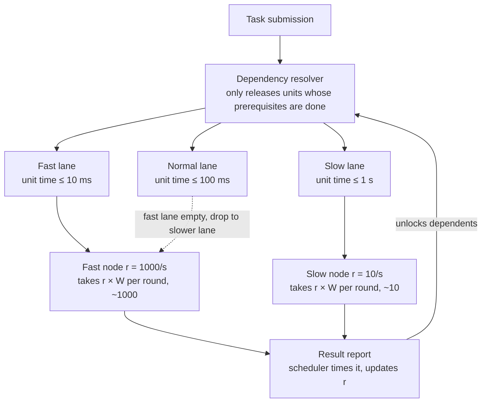

# Distributed Compute Unit Scheduling — Design

**English** | [中文](../zh-CN/scheduling-design.md)

Draft · 2026-10-22

## 1. Overview and goals

The goal is to have every node return its results inside the same time window, so that the aggregator's waiting time is independent of how fast or slow individual nodes are. Tasks are split into indivisible minimal compute units; each node decides how many units to take per round from its *measured* throughput. Fast nodes take more, slow nodes take less, and all of them return within the same window W.

**Problem being solved.** Heterogeneous nodes differ enormously in capability (in the running example, a fast node completes 1000 units per second while a slow node completes 10). Distributing equal counts makes fast nodes idle while they wait for slow ones, and each batch boundary is held back by the slowest participant.

**Design principles.**

- Nodes are unaware of task logic. They only pull units, compute, and return results.
- Capability is measured by the scheduler, never self-reported by nodes.
- Estimates will always carry error; the distribution mechanism itself must absorb it (end-of-batch tapering, timeout reclaim).
- Units must be idempotent so they can be re-issued or duplicated.

## 2. Concepts and terminology

| Term | Meaning |
| --- | --- |
| Minimal compute unit (unit) | An indivisible atomic computation; the basic granule for distribution and metering. A node may take many per round. |
| Task | A set of units joined by a logical relationship (strictly serial, partially dependent, or parallel). The relationship is fixed when the task is submitted. |
| Unit time t | Time from a node taking a unit to the scheduler receiving its result, network included. Measured by the scheduler. |
| Concurrency c | Number of units a node can execute at once (cores, VRAM, etc.). |
| Throughput r | Units a node completes per second, r = c ÷ t, with t measured under concurrency. |
| Time window W | Target duration of one pull round. A node takes r × W units and is expected to return them within W. |
| Lane (pool) | A task pool bounded by a per-unit time ceiling. Fast lanes have small ceilings, slow lanes large ones. |
| Threshold | A lane's per-unit time ceiling. A node whose t exceeds it is ineligible for that lane. |
| EWMA | Exponentially weighted moving average, used to smooth t and r. |

## 3. Architecture

Three layers, each with one responsibility: the dependency resolver releases only ready units into the pools; the pools are divided into lanes by per-unit time ceiling; nodes pull every W, taking `throughput × W` units. Results return to the scheduler, which updates the node's throughput and notifies the resolver to unlock dependents.



Thresholds and counts are illustrative, W = 1 s.

A submitted task passes through the resolver first, then enters a lane according to its timeliness requirement. Fast nodes pull from the fastest lane they qualify for and drop to slower lanes when it is empty; slow nodes can only pull from lanes they qualify for. Result reports go through the scheduler, which both times them and triggers unlocking.

## 4. Dependency resolver

The resolver does one thing: it places units whose prerequisites have all completed into the matching lane. Nodes only ever see units that can execute immediately.

1. On submission, the relationships between units are expanded into a directed acyclic graph: each unit records the set of units it depends on.
2. Units with no prerequisites enter a pool immediately; all others are *waiting* and sit in no pool.
3. When a unit's result reaches the scheduler, the resolver finds every unit that lists it as a prerequisite, checks whether all of that unit's prerequisites are done, and if so marks it ready and enqueues it.
4. A serial task has exactly one ready unit at a time; a parallel task has all units ready at once; partial dependency lies between. The node side is identical in all cases.

A task's aggregation happens when all of its units have returned. Task-level aggregation logic (how unit results combine into an answer) is defined at submission alongside the dependency graph; the resolver only triggers it, it does not compute it.

## 5. Pools and lanes

Each lane carries a per-unit time ceiling. Tasks pick a lane by their timeliness requirement; nodes qualify by measured t. The number of lanes and their ceilings depend on the workload; the table below is an example.

| Lane | Unit time ceiling | Suited to | Node eligibility |
| --- | --- | --- | --- |
| Fast | 10 ms | Latency-sensitive tasks, long serial chains | t ≤ 10 ms |
| Normal | 100 ms | General tasks | t ≤ 100 ms |
| Slow | 1 s | Relaxed deadlines, tolerant of slow nodes | t ≤ 1 s |

Rules between lanes:

- Fast traffic may drop down; slow traffic may never move up. On each pull, a node first checks the fastest lane it qualifies for and only moves to slower lanes when that one is empty.
- Nodes pull every W, so when new work lands in the fast lane, a fast node returns to it within at most W.
- A node that qualifies for no lane (t above the slowest ceiling) receives no units. It stays in the node table and is re-enabled when its t recovers.

Because eligibility uses a t that includes network transfer, a node with fast compute but poor connectivity naturally lands in a slower lane.

## 6. Node capacity measurement

Node capacity is derived by the scheduler from the round-trip time of real units. There is no separate benchmark phase and no self-reporting.

**Measurement.** For each round the scheduler records the time T from issuing n units to receiving all results; the round's throughput is r_round = n ÷ T. This value automatically includes network transfer and the node's current load, and a node cannot inflate it.

**Slow start.** A new node takes only c units on its first round (just enough to fill its concurrency). Once that completes, the scheduler has a first real r. Subsequent rounds grow with measured r until it stabilizes.

**Rolling update.** After each round, r is updated with an EWMA:

```
r_new = α · r_round + (1 − α) · r_old
```

A rolling standard deviation σ of r is maintained alongside. Distribution uses the conservative value r_safe = r − k × σ, so nodes with high variance naturally take less.

**Threshold and hysteresis.** Lane eligibility is judged on t = c ÷ r. To stop nodes flapping between lanes near a threshold: promotion requires N consecutive qualifying rounds, demotion happens after a single failing round. Err on the conservative side: a slow node wrongly admitted to a fast lane holds up a whole batch, whereas a fast node temporarily held in a slower lane costs little.

**Concurrency c.** Nodes report hardware parameters (cores, VRAM) for an initial value, but the measured r already reflects actual concurrency. c is used only for the slow-start first round and for converting r back to t.

## 7. Pull rules

Core rule: a fixed time window W. Each round a node takes r_safe × W units and is expected to return them within W. Fast and slow nodes take different quantities but return at the same time.

**Normal phase.** When a node pulls, the scheduler issues r_safe × W units, rounded down, with a minimum of c (to fill concurrency). A node whose allocation would fall below c is treated as unqualified.

**End-of-batch tapering.** When the remaining units R in a batch fall below the combined per-round pull of all active nodes, allocation switches from r × W to proportional shares:

```
n_i = ⌊ R · r_i / Σ_j r_j ⌋
```

This is equivalent to shrinking the window to R ÷ Σr. All nodes finish the final round together instead of the first fast node draining the queue while the others sit idle. The rounding remainder goes to the node with the largest r, because the last unit's completion time is the lower bound on the batch's completion.

**Timeout reclaim.** If a node has not returned a round after k × W, it is treated as offline and its units go back to the pool for reissue. If the node later returns them anyway, the first result wins and duplicates are discarded.

**Idempotency requirement.** Units may be reissued or duplicated, so execution must be side-effect free and repeatable with identical results. Results carry the unit ID and the scheduler deduplicates by ID.

**Straggler mitigation (optional).** When a batch has only a few nodes still working and the rest are idle, outstanding units can be duplicated to idle fast nodes; whichever result arrives first is used.

## 8. Data structures

Four object types; only the fields the scheduler needs are listed.

| Object | Fields | Notes |
| --- | --- | --- |
| Unit | id, task_id, lane, deps, status, input_ref, result_ref, assigned_node, issued_at | status ∈ {waiting, ready, issued, done}; deps is the set of prerequisite unit IDs; issued_at drives timeout detection |
| Task | id, lane, units, dag, aggregate_spec, status | dag is the unit dependency graph; aggregate_spec describes how unit results combine into the answer |
| Node | id, c, r, sigma, t, lane_eligible, consecutive_pass, last_seen, in_flight | r / sigma / t are maintained by the scheduler; consecutive_pass implements promotion hysteresis; in_flight is the set of issued, unreturned unit IDs |
| Lane | id, t_max, W, ready_queue | ready_queue holds ready units; W may be set per lane |

The scheduler also keeps two indexes: prerequisite unit ID → dependent units (for resolver unlocking), and node ID → in-flight units (for timeout reclaim).

## 9. Suggested parameter defaults

Initial values, to be tuned against production measurements. W is the key parameter; most others are expressed relative to it.

| Parameter | Suggested initial value | Rationale |
| --- | --- | --- |
| W (time window) | 1 s on a LAN, 3–5 s over the public internet | Should be ≥ 20× one network round trip or communication overhead eats the gain; smaller W means tighter batch boundaries and smaller loss on node failure, but more scheduler traffic |
| α (EWMA coefficient) | 0.3 | Larger reacts faster to new values; use smaller when node load fluctuates |
| k (safety factor) | 1 | r_safe = r − k × σ; k = 1 covers roughly 84% of variation |
| Timeout multiplier | 2 × W | Reclaim beyond this; too small misfires, too large magnifies loss on node failure |
| N (promotion hysteresis rounds) | 3 | Three consecutive qualifying rounds to move up; one failing round to move down |
| Lane ceilings | 10 ms / 100 ms / 1 s | Illustrative; set from the real timeliness requirements of the workload |
| First-round pull | c | Slow start: just fill concurrency |

## 10. Open questions and risks

Decisions still pending that affect implementation detail:

- [ ] Is unit cost uniform? If unit times vary widely, each unit needs an estimated cost, and "unit count" in the pull formulas becomes "total cost".
- [ ] Are nodes owned and controlled, or external and untrusted? External nodes need result verification (sampled recomputation) and malicious-node eviction.
- [ ] Is the scheduler a single instance or several? Multiple instances need a consistency scheme for ready queues and the node table.
- [ ] How large are results? Large results make return transfer a big share of t; either enlarge W or store results separately and return only references.

Known risks:

| Risk | Impact | Mitigation |
| --- | --- | --- |
| Few fast-lane tasks, fast nodes linger in slow lanes | New fast-lane work waits up to W before pickup | Give the fast lane its own smaller W |
| Sudden node capacity drop (thermal throttling, preemption) | Round returns later than W | EWMA + σ conservative pull; timeout reclaim as backstop |
| Too many lanes fragment the pools | Fast lanes empty, slow lanes backlogged | Drop-down rule already covers it; keep lanes to 3 or fewer |
| Non-idempotent units | Reissue or duplication yields wrong results | Require units to declare idempotency at submission and validate |

Optional enhancement: **critical-path priority**. For tasks with long serial chains, units on the chain may be placed in a faster lane even when the task's own deadline is relaxed, because chain length × unit time determines the task's completion time. Add once the base scheme is stable.
