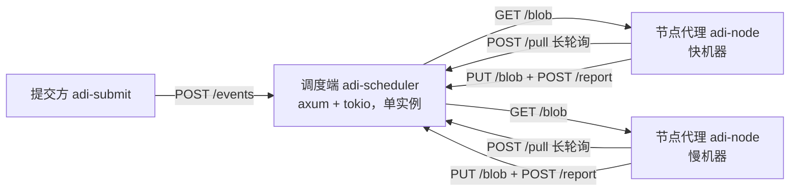

# 形态 A 原型设计

[English](../en/prototype-a-design.md) | **中文**

草案待审 · 2026-10-22

## 1. 目的与范围

用两三台真实的异构机器跑通"调度端 + 节点代理"，验证模拟器的预测：节点按实测吞吐取量后，汇总等待是否真的压到一个 W，效率是否接近模拟值。U 固定为分块矩阵乘（通用档，CPU），这是设计文档第 11 节的形态 A，也是机制验证最省的载体。

**做：**

- 调度端服务：节点注册、拉取（长轮询）、回报、超时回收、ET、依赖解析——逻辑直接复用模拟器的 `scheduler/` 模块。
- 节点代理：注册、拉取、按内容哈希取数据并缓存、多线程计算、上传结果、回报。
- 一种 U：C 的一个输出块 = A 的一行块 × B 的一列块（完整 K 累加，无归约阶段）。
- 与模拟器同格式的 rounds.csv / batches.csv / summary.txt，直接对照。

**不做（留到后续）：**

- IR 翻译器：U 的 logic_hash 是占位，节点内置 matmul 内核。
- 内容寻址存储的点对点分发：数据从调度端拉，节点本地缓存。
- 结果校验、恶意节点剔除、GPU 运行时、关键路径优先、拖尾兜底。

## 2. 进程结构



三个 Rust 二进制，一个共享库：

| 包 | 内容 |
| --- | --- |
| `crates/adi-core` | 从 `sim/src/scheduler/` 抽出的调度逻辑（节点表、ET、取量、迟滞、超时、解析器）+ `metrics`；模拟器和调度端共用 |
| `crates/adi-scheduler` | HTTP 服务，持有 `adi-core::Scheduler`（单实例，`Mutex` 保护），定时器每 W/4 跑一次超时检查，内容仓库（内存 + 磁盘） |
| `crates/adi-node` | 节点代理 |
| `crates/adi-submit` | 命令行：生成 A、B 矩阵，上传，提交 E，等待完成，校验 C |

`sim/` 改为依赖 `adi-core`，`engine.rs` 保持不变。调度逻辑只有一份，模拟器验证过的就是线上跑的。

## 3. 协议

控制面 JSON over HTTP/1.1（axum）；数据面二进制 blob。一轮一次往返，消息量小，JSON 足够；数据不走 JSON。

| 方法 | 路径 | 请求 | 响应 |
| --- | --- | --- | --- |
| POST | /nodes/register | `{node_id, tier, c, hardware: {cores, mem_bytes}}` | `{token, w, retry_ms}` |
| POST | /pull | `{node_id, wait_ms}` | 200 `{round_id, et, issued_at, units: [{u_id, e_id, logic_hash, input: {a, b, bi, bj, block}}]}`，或 204（等满 wait_ms 仍无工作） |
| POST | /report | `{node_id, round_id, started_at, finished_at, bytes_in, results: [{u_id, hash}]}` | 200 `{accepted: [u_id]}` |
| PUT | /blob/{hash} | 原始字节 | 201 |
| GET | /blob/{hash} | — | 原始字节 |
| POST | /events | `{a_hash, b_hash, block, et}` | `{e_id, units}` |
| GET | /events/{e_id} | — | `{status, done, total, c_hash?}` |
| GET | /metrics | — | rounds.csv / batches.csv / summary.txt 的当前内容 |

约定：

- 调度端自己记 issued_at（/pull 返回时）和 returned_at（/report 到达时），这是 t 的依据；节点上报的 started_at / finished_at 只用来把传输和计算分开，估 B。
- /pull 是长轮询：无工作时服务端挂住请求最多 wait_ms（= W/4），新 U 就绪时按"有资格且最快"唤醒一个挂起的请求。
- /report 带 round_id，迟到的回报（round 已回收）照常接收，结果按 u_id 先到先得。
- 幂等：同一 u_id 重复回报返回 `accepted: []`。
- 时间戳用服务端单调时钟（秒，f64），节点时钟不参与计时。

## 4. Unity：分块矩阵乘

E = 计算 C = A × B，A 为 M×K，B 为 K×N，f32。块大小 b（默认 64）。U(i, j) 计算 C 的第 (i, j) 块：

```
C[i·b .. (i+1)·b, j·b .. (j+1)·b] = Σ_k A[i 行块, k] · B[k, j 列块]
```

U 数 = ⌈M/b⌉ × ⌈N/b⌉，每个 U 的成本 = b × b × K 次乘加，均一。strict 档：对每个输出元素沿 K 升序逐项 f32 累加，任何节点结果逐位一致，提交方可直接比对。

数据引用：U 只带 a_hash、b_hash、bi、bj。节点首次见到某哈希时整块 GET 下来缓存（A、B 各一次），之后的 U 零传输。这就是设计里"数据走引用、节点缓存"的最小实现；对原型来说也意味着 B 的估计只在首轮有信号，后续轮 bytes_in = 0。

结果：每个 U 的 C 块（b × b × 4 字节，b = 128 时 64 KB）PUT 到 /blob，report 只带哈希。提交方最后按 u_id 拼出 C。结果上传在 report 之前完成，所以上传时间自然计入 t；公网节点的上传带宽会直接体现为更长的 t 和更低的 r，这正是设计里"t 含网络传输"的本意。

粒度：单 U 固定开销约 1 ms（JSON、哈希、HTTP），按"≥ 100 倍"规则 U 的计算应 ≥ 100 ms 在最慢机器上。b = 64、K = 4096 时一个 U 是 1680 万次乘加，单核约 10–30 ms——偏小。原型先用 b = 128（6700 万次乘加，单核 50–150 ms），实测后调。

## 4a. 部署形态：局域网与公网

机器不限、网络含公网，原型按下面的约束设计，局域网只是公网的特例：

| 约束 | 做法 |
| --- | --- |
| 节点可能在 NAT 后、无公网地址 | 所有连接由节点发起（注册、拉取、取数据、上传、回报），调度端不主动连节点。拉取模型天然满足。调度端需要一个可达地址：局域网内直接监听，公网部署时放在反向代理（TLS）后 |
| 公网往返 50–200 ms，远大于局域网的 1 ms | W 由 ET 决定，不是全局常量：局域网 ET W = 1 s，公网 ET W = 3–5 s（≥ 20 倍往返）。原型先用一个 ET、W = 3 s，两种网络的节点混跑，看 V1/V2 是否仍成立 |
| 公网上传带宽窄（常见 5–20 Mbps），b = 128 时每个 U 要上传 64 KB | 公网节点会被结果上传限速，这是真实约束，不绕开：t 含上传时间，r 自然变小，节点自动少取。实测会给出"公网节点的有效 r 比局域网低多少"，这是设计第 10 节数据成本模型的第一份真实数据 |
| 首次拉取 A、B 各 64 MB（4096²×f32），公网上要几十秒 | 只在首轮发生，且被首轮 B 的测量捕获；之后零传输。慢启动的首轮取 c 个 U，所以首轮耗时长不会放大后续取量 |
| 公网端点会被扫描 | 注册返回的 token 作为后续所有请求的 Bearer 头；原型只做这一层，TLS 交给反向代理 |
| 操作系统不限（Windows / Linux / macOS） | 纯 Rust、无系统依赖，`cargo build` 即可；节点代理的缓存目录和核数检测用跨平台库（`num_cpus`、`dirs`） |

公网节点因 t 偏大会自然落到较慢的 ET，这是设计里车道机制的预期行为；原型在验证第 6 项里专门看这一点。

## 5. 节点代理

```
注册 → 循环 {
  pull(wait = W/4)
  若 204：继续
  对 units 中未缓存的 a_hash / b_hash：GET /blob，存本地
  started_at = now
  rayon 并行计算 units（并发度 = c = 物理核数）
  finished_at = now
  每个结果 PUT /blob/{hash}（并发）
  report
}
```

- c 上报为物理核数；调度端的 c 只用于首轮慢启动和 t = c ÷ r 换算。
- 节点只认调度端给的 w 和 retry_ms，不自带参数。
- 进程被杀即"掉线"：无优雅下线，以验证超时回收和重连回收（重启后重新 register，调度端立即回收它的旧在途）。
- 缓存目录可配，启动时清空。

## 6. 调度端内部

- `adi-core::Scheduler` 原样：`pull(node, now)`、`round_done(obs, units)`、`check_timeouts(now)`、`node_reconnected(node)`、`submit(et, u, cost, bytes, deps)`。
- 一个 `tokio::sync::Mutex<Scheduler>`；每个 HTTP 处理器拿锁、调一次方法、放锁。调度决策是微秒级，锁不是瓶颈。
- 长轮询：每个节点一个 `tokio::sync::Notify`；空拉取的请求在 Notify 上等；`submit` / `round_done` / 回收后调用 `wake_parked()` 的服务端版本——按"有资格且最快"挑一个节点 notify。
- 定时器任务每 W/4 调 `check_timeouts(now)`。
- 内容仓库：`HashMap<hash, Bytes>` + 磁盘目录，哈希用 BLAKE3。
- 指标：复用 `adi-core::metrics`，/metrics 随时可读；进程退出时落盘。

## 7. 验证标准与对照方法

1. **单机 sanity**：1 个节点，M = N = K = 4096，b = 128 → 1024 个 U。C 与单线程参考实现逐位一致（strict）。
2. **双机异构**：1 快 1 慢（吞吐比最好 ≥ 5），顺序提交 10 个 E。看 summary.txt 的 V1（max − min ≤ 0.2 W）和 V2（≤ W）。
3. **模拟器对照**：用实测的每节点 r、B、latency 生成一个 scenario.toml，跑模拟器，比较 10 个 E 的总用时。**通过线：实测 ÷ 模拟 ≤ 1.15。** 超出就说明真实系统里有模拟器没建模的开销，要找出来。
4. **掉线**：E 运行中 kill 慢节点代理，10 s 后重启。看 V4 和重连回收是否生效（reissued > 0，late_results = 0 或有且被去重）。
5. **三机**（如果有第三台）：加一台中速机器，看三档吞吐下 V1/V2 是否仍成立。
6. **局域网 + 公网混跑**：至少一台公网节点与局域网节点同跑一个 ET（W = 3 s）。看公网节点的实测 r 与其计算能力的差距（上传限速的代价）、V1/V2 是否成立；再开两条 ET（局域网 W = 1 s、公网 W = 3 s），看公网节点是否自然落到慢 ET。

## 8. 工作量估计

| 阶段 | 内容 | 估计 |
| --- | --- | --- |
| P1 | 抽出 `adi-core`，模拟器改依赖，所有场景结果不变 | 0.5 天 |
| P2 | `adi-scheduler`：注册、长轮询拉取、回报、blob、超时定时器、/metrics | 1 天 |
| P3 | `adi-node` + `adi-submit`：矩阵生成、上传、拉取、rayon matmul（strict）、上传、回报、拼接校验 | 1 天 |
| P4 | 在你的两台机器上跑验证 1–3，写对照报告 | 0.5 天 |
| P5 | 掉线测试、第三台机器、两条 ET（快 / 慢） | 0.5 天 |

每阶段单独提交。P1 必须在你的机器上验证模拟器结果逐字节不变后才进 P2；P4 的实测数据进仓库 `results/real/`。

## 待你确认

- [x] 机器：CPU、核数、内存、操作系统不限；网络含局域网和公网（已确认，见 4a）。
- [ ] 控制面用 JSON over HTTP（简单、可 curl 调试），还是一开始就上二进制协议？建议先 JSON，瓶颈出现再换。
- [ ] 块大小 b = 128、K = 4096 的起点是否可以。
- [ ] 节点代理用 rayon（数据并行）即可，还是需要为后续 GPU 运行时预留后端抽象？建议现在预留一个 `trait Kernel { fn run(&self, u: &Unit) -> Block }`，CPU 实现一份，不多做。

后三项若无异议即按建议执行。
