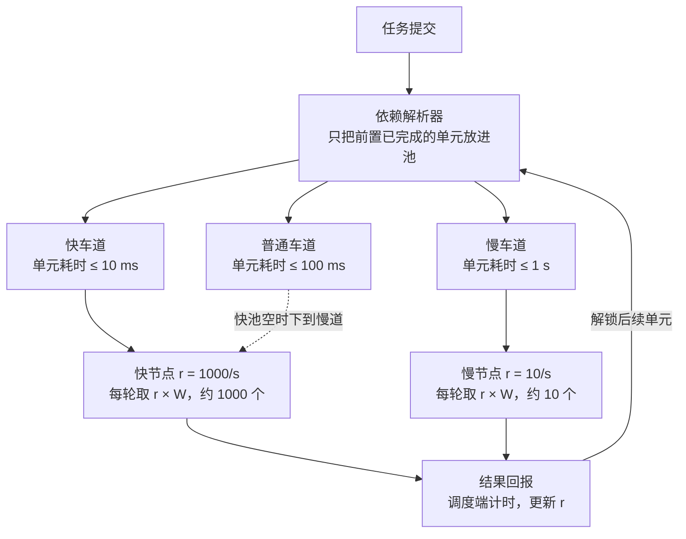

# 分布式计算单元调度设计

[English](../en/scheduling-design.md) | **中文**

草稿 · 2026-10-22

## 1. 概述与目标

目标是让所有节点在同一时间窗内交回结果，使汇总端的等待时间与节点快慢无关。做法是：任务拆成不可再分的最小计算单元，节点按自己的*实测*吞吐决定一次取多少个，快节点多取、慢节点少取，但都在同一个时间窗 W 内交回。

**要解决的问题。** 异构节点能力差异大（例子中快节点 1 秒跑 1000 个单元，慢节点 1 秒只跑 10 个），按数量平均分配会让快节点空等慢节点，批次之间的衔接被最慢节点拖住。

**设计原则。**

- 节点不感知任务逻辑，只做"取单元 → 计算 → 交回"。
- 能力由调度端实测，不信任节点自报。
- 估值一定有误差，分配机制本身要能吸收误差（收尾缩量、超时回收）。
- 单元必须幂等，重复执行结果一致，以便重发和复制重跑。

## 2. 核心概念与术语

| 术语 | 含义 |
| --- | --- |
| 最小计算单元（单元） | 不可再分的原子计算任务，是分配与计量的基本粒度；一个节点一次可取多个 |
| 任务 | 由多个单元按逻辑关系（串行 / 部分依赖 / 并行）组成；关系在提交进池时已确定 |
| 单元耗时 t | 某节点从取走一个单元到交回结果的时间，含网络传输，由调度端测量 |
| 并发度 c | 节点能同时执行的单元数（由核数、显存等决定） |
| 吞吐 r | 节点每秒能完成的单元数，r = c ÷ t（t 取并发下的实测值） |
| 时间窗 W | 每轮取量的目标时长；节点一次取 r × W 个单元，预期在 W 内交回 |
| 车道（池） | 按单元耗时上限划分的任务池，快车道上限小、慢车道上限大 |
| 门槛 | 某车道的单元耗时上限；节点 t 超过门槛则无资格从该池取单元 |
| EWMA | 指数加权滑动平均，用于平滑更新 t 和 r |

## 3. 整体架构

三层各司其职：依赖解析器只向任务池投放已就绪的单元；任务池按单元耗时上限分成多条车道；节点每隔 W 来取一轮，取量 = 自身吞吐 × W。结果回到调度端，调度端据此更新该节点的吞吐，并通知解析器解锁后续单元。



门槛与数量为示例，W = 1 s。

任务提交后先过解析器，再按时效要求进入某条车道；快节点优先取最快车道，空了再下到慢道，慢节点只能取自己达标的车道。结果回报走调度端，既完成计时，也触发解锁。

## 4. 依赖解析器

解析器只做一件事：把前置全部完成的单元放进对应车道，节点永远只看到可立即执行的单元。

1. 任务提交时，把单元之间的关系展开成一张有向无环图：每个单元记录它依赖的前置单元集合。
2. 没有前置的单元立即入池；其余单元处于"等待"状态，不进任何池。
3. 一个单元的结果回到调度端后，解析器找出以它为前置的单元，逐个检查前置是否全部完成，全部完成的转为就绪并入池。
4. 串行任务就是每次只有一个单元就绪；并行任务是全部同时就绪；部分依赖介于两者之间。节点侧处理完全一致。

一个任务的结果汇总 = 它所有单元都已交回。任务级的汇总逻辑（怎么把各单元结果拼成答案）在提交时和依赖关系一起定义，解析器只负责触发，不负责计算。

## 5. 任务池与车道

每条车道挂一个单元耗时上限，任务按时效要求选车道，节点按实测 t 判定资格。车道数量和上限由任务类型决定，下表为示例。

| 车道 | 单元耗时上限 | 适用任务 | 节点资格 |
| --- | --- | --- | --- |
| 快车道 | 10 ms | 时效敏感、串行链条长的任务 | t ≤ 10 ms |
| 普通车道 | 100 ms | 一般任务 | t ≤ 100 ms |
| 慢车道 | 1 s | 时效宽松、可容忍慢节点的任务 | t ≤ 1 s |

车道之间的规则：

- 快车可下慢道，慢车不能上快道。节点每次取任务，先查自己有资格的最快池，空了再往慢的池子找。
- 节点每隔 W 来取一次，所以快车道一旦有新任务，最多 W 时间快节点就会切回来。
- 任何池都不达标的节点（t 超过最慢车道上限）不发单元，只保留在节点表中，等它的 t 回落再启用。

资格判定用的 t 含网络传输，所以计算快但网络差的节点会自然落到较慢的车道。

## 6. 节点能力评估

节点能力由调度端从真实单元的往返时间中测出，不需要单独的跑分阶段，也不接受节点自报。

**测量。** 调度端记录每轮"发出 n 个单元"到"收到全部结果"的时间 T，本轮吞吐 r_本轮 = n ÷ T。这个值自动包含网络传输和节点当前负载，节点无法虚报。

**慢启动。** 新节点第一轮只取 c 个单元（刚好填满并发），跑完就有了第一个真实的 r。之后每轮按实测 r 放大取量，直到稳定。

**滚动更新。** 每轮结束后用 EWMA 更新：

```
r_new = α · r_本轮 + (1 − α) · r_old
```

同时维护 r 的滚动标准差 σ。分配时用保守值 r_保守 = r − k × σ，波动大的节点自然少取。

**门槛与迟滞。** 车道资格按 t = c ÷ r 判定。为避免节点在门槛附近反复跳车道：升级需要连续 N 轮达标，降级只要一轮不达标就降。宁可保守，因为一个慢节点误入快车道的代价（拖住整批）远大于一个快节点暂时待在慢车道的代价。

**并发度 c。** 由节点上报硬件参数（核数、显存）给出初值，但 r 的测量已经隐含了实际并发效果，c 只用于慢启动的首轮取量和 t 的换算。

## 7. 取量规则

核心规则：固定时间窗 W，节点每轮取 r_保守 × W 个单元，预期在 W 内交回。快慢节点取量不同，交回时间相同。

**正常阶段。** 节点来取时，调度端按它的 r_保守 × W 发放，向下取整，至少发 c 个（填满并发）。取量少于 c 的节点视为不达标。

**批次收尾缩量。** 当某批次剩余单元数 R 小于所有活跃节点一轮总取量时，不再按 r × W 发放，改为按比例分：

```
n_i = ⌊ R · r_i / Σ_j r_j ⌋
```

相当于时间窗自动缩短到 R ÷ Σr。这样最后一轮各节点同时完成，而不是先到的快节点拿走全部、其他节点空等。取整后的零头留给 r 最大的节点，因为最后一个单元的耗时是批次完成时间的下限。

**超时回收。** 节点取走一轮后，超过 k × W 未交回，视为掉线：这批单元放回池子重新发放。节点后来又交回的话，以先到的结果为准，重复的丢弃。

**幂等要求。** 单元可能被重发或复制重跑，所以单元的执行必须无副作用、重复执行结果一致。结果交回时带单元 ID，调度端按 ID 去重。

**拖尾兜底（可选）。** 某批次只剩少数节点仍在执行、其余节点空闲时，可把未交回的单元复制给空闲的快节点重跑，谁先交回用谁的。

## 8. 数据结构

四类对象，字段只列调度所需的最小集合。

| 对象 | 字段 | 说明 |
| --- | --- | --- |
| 单元 Unit | id, task_id, lane, deps, status, input_ref, result_ref, assigned_node, issued_at | status 取 waiting / ready / issued / done；deps 为前置单元 id 集合；issued_at 用于超时判定 |
| 任务 Task | id, lane, units, dag, aggregate_spec, status | dag 为单元依赖图；aggregate_spec 描述各单元结果如何拼成答案 |
| 节点 Node | id, c, r, sigma, t, lane_eligible, consecutive_pass, last_seen, in_flight | r / sigma / t 由调度端维护；consecutive_pass 用于升级迟滞；in_flight 为当前已取走未交回的单元 id 集合 |
| 车道 Lane | id, t_max, W, ready_queue | ready_queue 为就绪单元队列；W 可按车道单独设置 |

调度端还维护两张索引：按前置单元 id 反查下游单元（解析器解锁用），按节点 id 查在途单元（超时回收用）。

## 9. 参数取值建议

以下为初始值，上线后按实测调整。W 是最关键的一个，其余参数多数以 W 为基准。

| 参数 | 建议初值 | 取值依据 |
| --- | --- | --- |
| W（时间窗） | 局域网 1 s，公网 3–5 s | 应 ≥ 20 倍单次往返网络开销，否则通信成本吃掉收益；越小衔接越紧、掉线损失越小，但调度通信越多 |
| α（EWMA 系数） | 0.3 | 越大对新值越敏感；节点负载波动大时取小一些 |
| k（保守系数） | 1 | r_保守 = r − k × σ；取 1 约覆盖 84% 的波动 |
| 超时倍数 | 2 × W | 超过即回收重发；太小会误判，太大则掉线损失大 |
| N（升级迟滞轮数） | 3 | 连续 3 轮达标才升车道；降级 1 轮即降 |
| 车道上限 | 10 ms / 100 ms / 1 s | 示例值，按任务类型的实际时效要求定 |
| 首轮取量 | c | 慢启动，填满并发即可 |

## 10. 待定项与风险

以下决策尚未定，会影响实现细节：

- [ ] 单元成本是否均一？若不同单元耗时相差大，需给单元挂预估成本，取量公式中的"单元数"改为"成本总和"。
- [ ] 节点是自有可控机器还是外部不可控节点？外部节点要额外考虑结果校验（抽样复算）和恶意节点剔除。
- [ ] 调度端是单点还是多实例？多实例需要就绪队列和节点表的一致性方案。
- [ ] 结果数据量有多大？结果大时网络回传占比高，W 要相应放大，或结果走独立存储只回传引用。

已知风险：

| 风险 | 影响 | 缓解 |
| --- | --- | --- |
| 快车道任务少、快节点长期在慢道 | 快车道新任务到达后最多延迟 W 才被接走 | 快车道单独用更小的 W |
| 节点能力突变（降频、被抢占） | 本轮交回晚于 W | EWMA + σ 保守取量；超时回收兜底 |
| 车道太多导致池子碎片化 | 快池空、慢池积压 | 快车可下慢道的规则已覆盖；车道数建议不超过 3 |
| 单元非幂等 | 重发、复制重跑产生错误结果 | 提交时强制校验单元声明为幂等 |

可选增强：**关键路径优先**。串行链条长的任务，即使本身时效要求不高，也可把它链上的单元放进更快的车道，因为链条长度 × 单元耗时决定整个任务的完成时间。可在基础方案稳定后再加。
