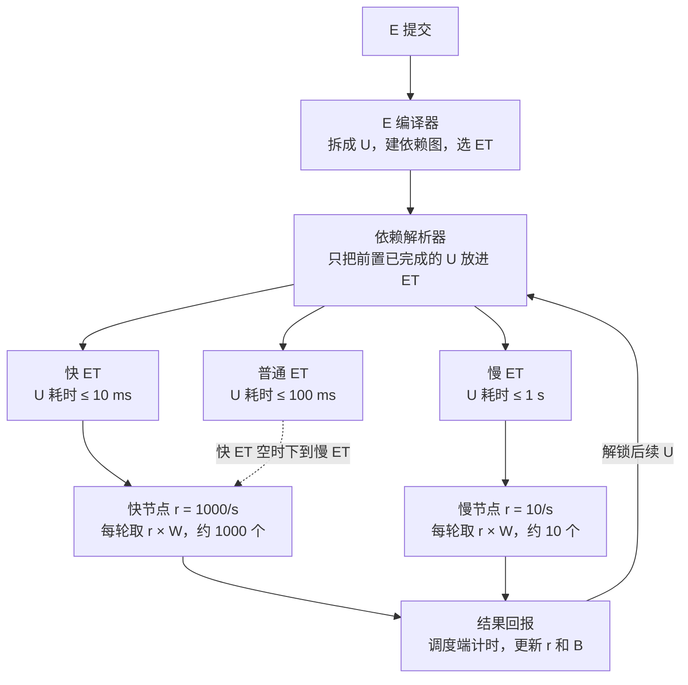

# 分布式计算调度设计（U / E / ET）

[English](../en/scheduling-design.md) | **中文**

草稿 v2 · 2026-10-22

## 1. 概述与目标

目标是让所有节点在同一时间窗内交回结果，使汇总端的等待时间与节点快慢无关。做法是：计算拆成不可再分的最小颗粒 Unity（U），节点按自己的*实测*吞吐决定一次取多少个，快节点多取、慢节点少取，但都在同一个时间窗 W 内交回。

**要解决的问题。** 异构节点能力差异大（例子中快节点 1 秒跑 1000 个 U，慢节点 1 秒只跑 10 个），按数量平均分配会让快节点空等慢节点，批次之间的衔接被最慢节点拖住。

**设计原则。**

- 节点不感知任务逻辑，只做"取 U → 计算 → 交回"。
- 能力由调度端实测，不信任节点自报。
- 估值一定有误差，分配机制本身要能吸收误差（收尾缩量、超时回收）。
- U 必须幂等，重复执行结果一致，以便重发和复制重跑。
- 调度端不做任何计算，连结果汇总也由节点执行，这才是真正的去中心化。

## 2. 术语

| 术语 | 缩写 | 含义 |
| --- | --- | --- |
| Unity | U | 不可再分的最小计算颗粒：一个算子子图 + 它的输入切片，自包含、幂等。分配与计量的基本单位，一个节点一次可取多个 |
| Event | E | 由一个或多个 U 组成的最小任务事件；U 之间的关系（串行 / 部分依赖 / 并行）在 E 编译时确定 |
| Event Trench | ET | 承载多个 E 的缓冲池，按硬件能力档和 U 耗时上限两个维度划分（即此前的"车道"） |
| 中间表示 | IR | U 的计算逻辑的硬件无关编码，定在**张量算子图**层级；节点侧运行时翻译成本机代码 |
| 单元耗时 | t | 某节点从取走一个 U 到交回结果的时间，含网络传输，由调度端测量 |
| 并发度 | c | 节点能同时执行的 U 数（由核数、显存等决定） |
| 吞吐 | r | 节点每秒完成的 U 数，r = c ÷ t（t 取并发下的实测值） |
| 带宽 | B | 节点拉取数据的实测速率，与 r 分开测 |
| 时间窗 | W | 每轮取量的目标时长；节点一次取 r × W 个 U，预期在 W 内交回 |
| 门槛 | — | 某 ET 的 U 耗时上限；节点 t 超过门槛则无资格从该 ET 取 U |
| EWMA | — | 指数加权滑动平均，用于平滑更新 t、r、B |

"Unity" 与 Unity 游戏引擎同名，对外文档首次出现时注明本项目含义。

## 3. 整体架构

三层各司其职：依赖解析器只向 ET 投放已就绪的 U；ET 按硬件档和耗时上限分成多条；节点每隔 W 来取一轮，取量 = 自身吞吐 × W。结果回到调度端，调度端据此更新该节点的吞吐，并通知解析器解锁后续 U。



门槛与数量为示例，W = 1 s。图中只画了耗时维度，硬件档维度见第 6 节。

E 提交后先由编译器拆成 U 并选定 ET，再经解析器按依赖关系投放；快节点优先取最快的 ET，空了再下到慢的，慢节点只能取自己达标的 ET。结果回报走调度端，既完成计时，也触发解锁。

## 4. Unity

### 4.1 封装结构

U 是自包含的最小颗粒，借鉴 Wasm 的跨硬件**原理**（一份硬件无关的 IR + 各平台运行时翻译），不使用 Wasm 本身。一个 U 的包结构：

| 字段 | 说明 |
| --- | --- |
| u_id | 全局唯一标识，内容哈希 |
| e_id | 所属 E |
| logic_hash | 计算逻辑（IR 子图）的内容哈希；逻辑按引用，不内嵌 |
| input | 输入切片：小于内联阈值时直接内嵌，否则为内容地址引用 |
| output_schema | 输出形状、类型，以及校验方式（精确比对 / 容差 ε） |
| hardware_req | 该 IR 子图所需的最低硬件档（由算子集推出） |
| created_at | 创建时间戳，用于 E 级超时和 ET 内排序 |
| nonce | 防止同内容 U 的 id 冲突 |

逻辑和大输入都按引用：一个 E 衍生百万个 U 时，同一份 IR 只传一次，节点首次见到即拉取、翻译、缓存。

### 4.2 IR：张量算子图

IR 定在张量算子图层级（同类：ONNX、StableHLO），不是通用字节码。原因：

- 算子集小（初期控制在 30 个以内：矩阵乘、逐元素运算、归约、形状变换、少量激活函数），翻译到 GPU / NPU / LPU 直接。
- 同 logic_hash 的 U 天然可合并批处理（见 4.4）。
- 数据流图没有任意分支，确定性容易保证。

控制流（循环、条件）不放进 U，由 E 层表达：E 可以衍生 E，循环和分支体现在依赖图上（见 5.3）。

节点侧运行时：每种硬件一个运行时，把 IR 翻译成本机代码并缓存；IR 只能访问 U 自带的输入和声明的输出，没有文件、网络、系统调用——这是接纳不可信节点的沙箱前提。

### 4.3 粒度规则

"不可再分"是逻辑上的，粒度大小要定量：

> U 在最慢的合格硬件上的计算时间 ≥ 单 U 固定开销（包头、调度、翻译）的 100 倍。

例如固定开销 1 ms，则 U 的计算量至少要让慢节点跑 100 ms。这个比值是 E 编译时的参数。太小，固定开销压过计算；太大，拖尾变长。

### 4.4 批处理

U 保持小，GPU 的效率靠节点侧合并补回：同 logic_hash 的 U 可合并成一批执行，GPU 节点一次取几千个同逻辑的 U，合成一次大核调用。这与"一个节点可同时取多个 U"的设定一致，不需要按硬件分别编译。

### 4.5 确定性

CPU 上的整数和浮点运算在 IR 层约定好归约顺序后可精确比对；GPU 的浮点归约顺序不固定，跨节点校验用容差。output_schema 里声明比对方式。

## 5. Event

### 5.1 编译与简化

E 提交时由编译器拆成 U 并建依赖图。复杂计算要先简化成兼容性更好的基本算子（高维矩阵分块成小块乘加），分块后的"乘 → 加"两级依赖由解析器自然处理。

无法简化的逻辑（需要特定精度的张量核、特殊算子）在编译时按算子集推出 hardware_req，投入对应硬件档的 ET，等待合格节点提取。

### 5.2 汇总作为 U

E 的汇总逻辑（aggregate_spec）编译成一个依赖所有其他 U 的"归约 U"，由节点执行，调度端不参与计算。大 E 的汇总可以是多级归约树。

### 5.3 E 衍生 E

迭代类算法（收敛判断后再来一轮）在 E 的结果出来后动态生成新 E 并挂依赖。依赖图允许运行时扩展，不要求提交时固定。

### 5.4 状态机

**U 的状态：** `ready → issued → done`，旁路 `reissued`（超时回收后重发，计数 +1）和 `verified`（抽样复算通过）。重发次数超过上限标为 `failed`，向上传导到 E。

**E 的状态：**

| 状态 | 进入条件 |
| --- | --- |
| created | 已提交，尚未编译 |
| compiled | 已拆成 U 并建好依赖图 |
| queued | 至少一个 U 已进入 ET，尚无 U 被取走 |
| computing | 至少一个 U 已被取走 |
| dispatched | 全部 U 已被取走（computing 的子状态，issued_count = total） |
| aggregating | 全部 U 已返回，归约 U 正在执行 |
| completed | 归约完成 |
| failed | 任一 U 超过重试上限，或 E 级超时 |
| cancelled | 提交方撤回；在途 U 的结果到达后直接丢弃 |

状态不单独存，由 `total / issued_count / done_count / failed_count` 四个计数器推导，避免状态和计数不一致。

### 5.5 补充规则

- E 内 U 的顺序由依赖图决定；ET 内 E 的顺序默认 FIFO，可按截止时间或关键路径长度排优先级。
- E 级超时独立于 U 级超时：U 超时触发重发，E 超时触发失败。
- 时间戳用途：created_at 用于 E 级超时和 ET 内排序；issued_at 由调度端记录用于 U 级超时；节点回报时带 started_at / finished_at，调度端据此把计算时间和传输时间分开。

## 6. Event Trench

### 6.1 两个维度

ET 的键 = (硬件能力档, U 耗时上限)。

硬件能力档描述符：`{backend, min_mem, features}`。为避免碎片化，初期只分三档：

| 档 | 覆盖 |
| --- | --- |
| 通用 | 任何能运行基础算子集的 CPU |
| GPU 通用 | 支持通用 GPU 运行时的设备 |
| 专用 | 特定 GPU 架构、NPU、LPU，需要特殊算子 |

耗时上限示例：

| ET | U 耗时上限 | 适用 E |
| --- | --- | --- |
| 快 | 10 ms | 时效敏感、串行链条长 |
| 普通 | 100 ms | 一般 |
| 慢 | 1 s | 时效宽松、可容忍慢节点 |

节点资格 = 硬件匹配（硬条件）且实测 t 达标（软条件）。资格用的 t 含网络传输，计算快但网络差的节点会自然落到较慢的 ET。

### 6.2 ET 之间的规则

- 快车可下慢道，慢车不能上快道。节点每次取 U，先查自己有资格的最快 ET，空了再往慢的找。耗时上限相同的 ET 之间，先查**本档**的：GPU 节点先做只有它能做的 GPU 工作，再下到通用 ET。（模拟器第 5 阶段实测：不这样排序时 GPU 节点先去通用 ET，GPU 工作被晾着。）
- 节点每隔 W 来取一次，所以快 ET 一有新 U，最多 W 时间快节点就会切回来。
- 任何 ET 都不达标的节点不发 U，保留在节点表中，等 t 回落再启用。
- 背压：ET 里就绪 U 超过容量时暂停向它编译新 E，不无限堆积。

## 7. 依赖解析器

解析器只做一件事：把前置全部完成的 U 放进对应 ET，节点永远只看到可立即执行的 U。

1. E 编译后，每个 U 记录它依赖的前置 U 集合。
2. 没有前置的 U 立即入 ET；其余 U 处于"等待"状态，不进任何 ET。
3. 一个 U 的结果回到调度端后，解析器找出以它为前置的 U，逐个检查前置是否全部完成，全部完成的转为就绪并入 ET。
4. 串行 E 每次只有一个 U 就绪；并行 E 全部同时就绪；部分依赖介于两者之间。节点侧处理完全一致。

## 8. 节点能力评估

节点能力由调度端从真实 U 的往返时间中测出，不需要单独的跑分阶段，也不接受节点自报。

**两个数，不是一个。** 调度端分别测计算吞吐 r 和带宽 B。U 声明输入大小 S，预计耗时 = 计算时间 + S ÷ B。GPU 强但网络差的节点会被分到"算得多、传得少"的 U，而不是整体降档。

**测量。** 节点回报带 started_at / finished_at，调度端用它们分离计算时间和传输时间。每轮吞吐 r_本轮 = n ÷ 计算时间，带宽 B_本轮 = 本轮数据量 ÷ 传输时间。

**慢启动。** 新节点第一轮只取 c 个 U（刚好填满并发），跑完就有了第一个真实的 r 和 B。爬升期每轮直接用最新实测值（α = 1）取整窗的量，直到相邻两轮实测相差 < 5% 视为稳定，再切到 EWMA。爬升期的轮次不计入稳态统计。（模拟器第 1 阶段实测：按 α = 0.3 从首轮爬升需要十几轮，直接替换只需 3 轮。）

**滚动更新。** 每轮结束后用 EWMA 更新：

```
r_new = α · r_本轮 + (1 − α) · r_old
```

B 同理。同时维护 r 的滚动标准差 σ，分配用保守值 r_保守 = r − k × σ，波动大的节点自然少取。

**按轮长加权。** 收尾缩量阶段的小轮时长远小于 W，固定往返开销占比大，实测 r 严重偏低；若与整窗轮同权更新，估值会在每个批次末尾塌下去。因此 α_eff = α × min(1, 本轮时长 ÷ W)。（模拟器第 1 阶段实测：不加权时估值从 990 跌到 226，加权后稳定在 986。）

**小于 c 的轮不算测量。** 一轮的 U 数少于并发度 c 时，硬件都没填满，测到的是往返开销而不是吞吐，这样的轮不更新 r。串行链每步只有 1 个 U，几百步累积会把估值拉低一半，加权也挡不住。（模拟器第 5 阶段实测：GPU 节点估值 1039 → 1973，真值 2000。）

**门槛与迟滞。** ET 资格按 t = c ÷ r 判定，迟滞有两重：数值上，升档要求 t ≤ t_max × (1 − band)，降档只要 t > t_max；时间上，升档还需连续 N 轮达标，降档一轮即降。宁可保守：慢节点误入快 ET 会拖住整批，快节点暂留慢 ET 代价很小。（模拟器第 3 阶段实测：对慢漂移的节点，只有时间迟滞时升降档次数仅减少 0–50%，因为节点确实在线两侧来回漂；band = 0.2（约 2 倍漂移幅度）时减少 83–94%。）

**并发度 c。** 对 AI 类 U 主要由显存决定：U 声明所需显存，节点的 c 按剩余显存算。硬件参数给初值，r 的测量已隐含实际并发效果。

## 9. 取量规则

核心规则：固定时间窗 W，节点每轮取 r_保守 × W 个 U，预期在 W 内交回。

**正常阶段。** 按 r_保守 × W 发放，向下取整，至少 c 个。取量少于 c 的节点视为不达标。

**批次收尾缩量。** 当某批次剩余 U 数 R 小于所有活跃节点一轮总取量时，改为按比例分：

```
n_i = ⌊ R · r_i / Σ_j r_j ⌋
```

相当于时间窗自动缩短到 R ÷ Σr，最后一轮各节点同时完成。取整零头给 r 最大的节点，因为最后一个 U 的耗时是批次完成时间的下限。

Σr 和"r 最大的节点"都只算**当前实际服务该 ET 的节点**：空闲的，或在途工作来自该 ET 的。正在别的 ET 忙的节点不算，它只在自己的 ET 空了才会下来。节点在一个 ET 分到 0 个时（零头留给更快节点），继续到下一个有资格的 ET 取。（模拟器第 3 阶段实测：不这样做时，慢 ET 的零头等一个永远不来的快节点，一个 500 U 的 E 卡了 310 s。）

**份额小于单个 U 时。** 缩量公式假定单个 U 的成本远小于份额；归约 U 这类大 U 或最后的零头会打破这个假定——谁的份额都装不下它，它就永远留在队首。规则：当前**空闲**节点里最快的那个把队首 U 整个拿走，不管份额。"最快"只在空闲节点里比，正忙的节点要等它这轮结束才可能来。（模拟器第 5 阶段实测：成本 20 的归约 U 卡死整个 ET 直到仿真上限。）

**空闲节点的唤醒。** 空闲节点取不到 U 时挂起请求（长轮询），调度端在新 U 就绪时立即唤醒有资格且最快的那个，而不是让它按周期重试。串行链每步解锁后若要等重试周期，一条 300 步的链会慢 9 倍。

**超时回收。** 超过 k × W 未交回视为掉线，U 放回 ET 队首重发；节点重新上线时若调度端仍记着它的在途，立即回收，不等超时。节点后来又交回的话以先到为准，重复的丢弃。超时倍数可按节点历史在线时长个别化。

**活性判定。** 调度端不知道谁掉线了，但空闲节点每 W/4 来拉一次，所以"最近联系时间"就是活性信号：没有在途、且超过 2 个拉取周期没联系的节点，不计入 Σr 和"最快节点"。（模拟器第 4 阶段实测：不判活时，掉线节点的在途被回收后它在调度端眼里仍是"空闲且最快"，零头一直留给它，效率 0.54；判活后 0.78，而离线比例 20% 决定的上限是 0.80。）

节点在事件末尾掉线时，其他节点只能等超时回收，所以有掉线时尾部等待的上限是超时倍数 × W + 重做时间，不再是 1 × W；可选的拖尾兜底（复制重跑）能把它压回去。

**幂等要求。** U 可能被重发或复制重跑，执行必须无副作用、结果可重复。结果带 u_id，调度端按 id 去重。

**拖尾兜底（可选）。** 批次只剩少数节点仍在执行时，把未交回的 U 复制给空闲快节点，谁先交回用谁的。

## 10. 数据调度

**数据走引用。** U 只带输入的内容地址，数据放在内容寻址存储里，节点按需拉取并本地缓存。调度端不再是数据瓶颈；同一哈希永远是同一份数据，幂等性有保证；重发 U 不用再传数据。大结果同理：写入存储，只回报引用加哈希。

**预取。** 节点跑第 n 轮时，调度端就把第 n+1 轮的 U 列表发给它，节点后台拉数据，传输与计算重叠（双缓冲）。

**亲和性。** U_B 依赖 U_A 的结果时，优先发给刚算完 U_A 的节点，中间结果不出节点。规则是"亲和优先，但不等"：该节点不空闲或没资格，就传给别人。

**点对点分发。** 同一份数据（模型权重、公共参考数据）被很多节点需要时，让已有的节点互相分发，内容寻址天然支持校验。避免调度端或中心存储成为单点。

## 11. 延伸到异构 AI 计算

三种形态与本机制的契合度不同：

**形态 A：大量独立的推理请求（批量推理、embedding、图像生成）。** 最契合，U = 一个请求或一个微批。要改的是 ET 的划分依据：加上**模型驻留**。模型加载耗时远大于单次推理，节点一旦加载某模型就应持续吃该模型的 U。每个模型一条 ET，资格两维：显存够装（硬）+ 实测吞吐（软）。切模型的加载成本计入，只有当前 ET 长期空才切。非实时下 W 可放大到分钟级。

**形态 B：单模型大到一个节点装不下（流水线并行）。** 模型按层切段，每段一个节点，U = 一个微批流过一段，依赖天然是链式。关键是**按吞吐分配层数**：快节点多拿几层，目标是每段处理时间相等——与"按能力取量、同时完成"同一原理，取量对象从 U 数变成层数。相邻段之间传激活值，要测**节点对之间**的带宽，把相邻段放在链路好的节点对上。

**形态 C：训练或微调。** 数据并行下原理仍适用：每节点每步 batch ∝ 吞吐，各节点同时到达同步点。但梯度同步的通信量和过期问题是另一套课题，后置。

**三种形态共同需要：**

- 抢占和撤离：闲置资源随时会被收回。U 要短，或长 U 内部做检查点；超时倍数按节点历史在线时长定。
- 不可信节点校验：抽样 5–10% 的 U 发给两个节点，LLM 用贪心解码比对 token 序列，数值结果用容差比对；不一致的节点降权直到剔除。
- 显存作为能力维度：见第 8 节并发度 c。

建议顺序：先做形态 A 验证整套机制，再加形态 B。

## 12. 数据结构

| 对象 | 字段 | 说明 |
| --- | --- | --- |
| Unity | u_id, e_id, logic_hash, input, output_schema, hardware_req, created_at, nonce, deps, status, assigned_node, issued_at, retry_count | 前 8 项为包内容（4.1）；后 5 项为调度端维护的状态 |
| Event | e_id, et_id, units, dag, aggregate_spec, total, issued_count, done_count, failed_count, deadline, parent_e_id | 状态由四个计数器推导；parent_e_id 用于 E 衍生 E |
| Node | id, hardware_profile, c, r, sigma, B, t, et_eligible, consecutive_pass, last_seen, online_history, in_flight, cached_logic, cached_data | r / sigma / B / t 由调度端维护；cached_* 用于亲和性和预取 |
| Event Trench | et_id, hardware_tier, t_max, W, capacity, ready_queue | 键 = (hardware_tier, t_max)；capacity 用于背压 |

调度端另维护三张索引：前置 U → 下游 U（解锁用），节点 → 在途 U（超时回收用），内容哈希 → 持有节点（亲和性与点对点分发用）。

## 13. 参数取值建议

| 参数 | 建议初值 | 取值依据 |
| --- | --- | --- |
| W（时间窗） | 局域网 1 s，公网 3–5 s，非实时 AI 可到分钟级 | 应 ≥ 20 倍单次往返网络开销；越小衔接越紧、掉线损失越小，但调度通信越多 |
| 粒度比 | 100 | U 计算时间 ÷ 单 U 固定开销 |
| 内联阈值 | 4 KB | 输入小于此值内嵌在 U 里，否则走引用 |
| 算子集大小 | ≤ 30 | 初期 IR 算子数，够覆盖矩阵类和推理类计算 |
| α（EWMA 系数） | 0.3 | 越大对新值越敏感；负载波动大时取小 |
| k（保守系数） | 1 | r_保守 = r − k × σ，约覆盖 84% 的波动 |
| 超时倍数 | 2 × W | 可按节点历史在线时长个别化 |
| N（升级迟滞轮数） | 3 | 连续 3 轮达标才升；降 1 轮即降 |
| band（升档门槛带） | 0.2 | 升档要求 t ≤ 0.8 × t_max；应取约 2 倍漂移幅度（模拟实测） |
| 抽样校验比例 | 5–10% | 对不可信节点 |
| 硬件档数 | 3 | 通用 / GPU 通用 / 专用 |
| 首轮取量 | c | 慢启动 |

## 14. 待定项与风险

已决（2026-10-22）：

| 事项 | 决定 |
| --- | --- |
| 节点信任模型 | 按不可信设计，接口预留；初期只接自有机器，校验和剔除暂不启用 |
| 调度端 | 先单点；多实例一致性后置 |
| 内容寻址存储 | 中心存储 + 节点缓存；点对点分发为后续优化 |
| IR 算子清单 | 见 [IR 算子集 v0](ir-ops-v0.md)（草案待审） |
| 语言 | Rust（调度端、节点代理、模拟器） |
| 硬件档 | 先做通用（CPU）+ GPU 通用两档 |
| 实施顺序 | 先写调度模拟器验证机制（见 [调度模拟器设计](simulator-design.md)），再做形态 A 原型 |
| U 成本 | 不再假设均一：成本 = 计算成本 + 数据成本（S ÷ B），两项分开估 |

尚待定：

- [ ] IR 算子 v0 清单中的三个确认项（范围、gelu 形式、fast 档容差）。
- [ ] 模拟器设计中的四个确认项（通过线、场景、代码分层、交付节奏）。

已知风险：

| 风险 | 影响 | 缓解 |
| --- | --- | --- |
| 快 ET 任务少、快节点长期在慢 ET | 快 ET 新 U 到达后最多延迟 W | 快 ET 单独用更小的 W |
| 节点能力突变（降频、被抢占） | 本轮交回晚于 W | EWMA + σ 保守取量；超时回收兜底 |
| ET 两维划分导致碎片化 | 某些 ET 长期空、某些积压 | 硬件档限 3、耗时档限 3，共最多 9 条；下道规则已覆盖 |
| U 非幂等 | 重发、复制重跑产生错误结果 | IR 无副作用由沙箱保证；提交时校验 |
| IR 翻译质量差 | 某硬件上 U 跑得远慢于原生 | 先做通用档和一种 GPU 运行时，实测后再扩 |

可选增强：**关键路径优先**。串行链条长的 E，即使时效要求不高，也可把链上的 U 放进更快的 ET，因为链条长度 × U 耗时决定整个 E 的完成时间。基础方案稳定后再加。（模拟器第 5 阶段实测：链与并行工作共用一条 W = 1 s 的 ET 时，链的每一步解锁后要等某个节点的整窗轮结束才有人接，300 步的链用了 40 s；ET 空闲时同一条链 4.5 s。把链放进 W 更小的 ET 就是这条增强。）

可选增强：**拖尾兜底（复制重跑）**。有掉线时尾部等待上限是超时倍数 × W + 重做时间（模拟器第 4 阶段实测 1.5–4.8 s），把末尾节点的在途复制给空闲节点可压回去。
